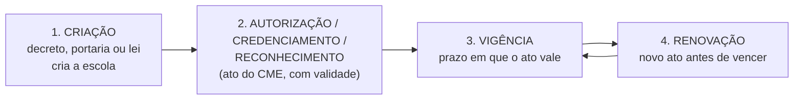
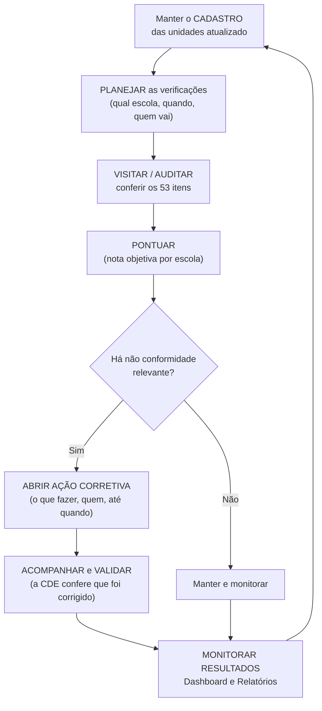
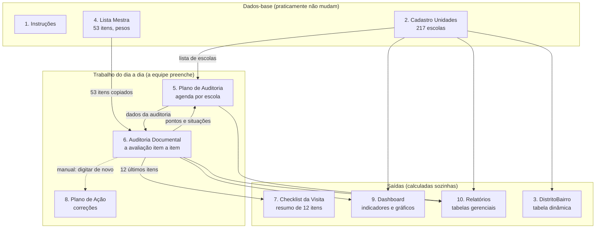
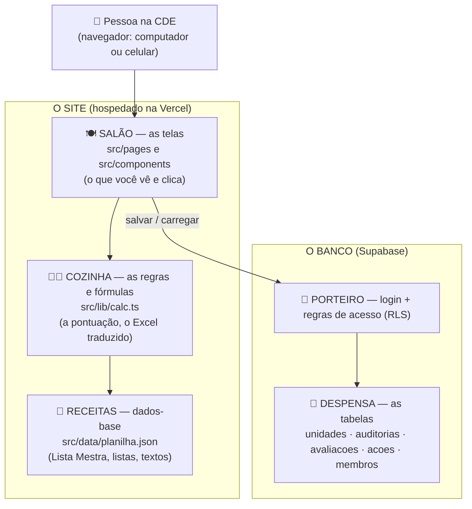
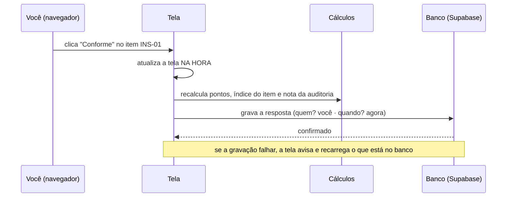

# Entendendo a planilha e o site — guia para o João

> **Para quem é este documento:** para quem **não conhece o assunto** (documentação escolar, auditoria, Excel avançado, banco de dados).
> Nada aqui pressupõe conhecimento prévio: cada termo técnico é explicado na primeira vez em que aparece, e há um **glossário** no fim.
>
> **O que você vai encontrar:**
> 1. **O assunto do zero** — o que é "documentação escolar", por que alguém precisa controlá-la e quem faz isso.
> 2. **O que a planilha de Excel fazia** — aba por aba, coluna por coluna, fórmula por fórmula, em linguagem simples, com exemplos reais dos dados.
> 3. **Os problemas que a planilha tinha** (com provas tiradas do próprio arquivo).
> 4. **Como cada parte virou site** — o que foi copiado fielmente, o que foi melhorado e o que foi criado.
> 5. **Como o site funciona por dentro**, sem jargão, e **o que ainda precisa ser confirmado com a CDE**.

## Como ler (escolha a trilha)

| Se você quer… | Leia |
|---|---|
| Entender tudo em 5 minutos | [Parte 1](#parte-1--resumo-em-uma-página) e [Parte 10](#parte-10--perguntas-para-confirmar-com-a-cde) |
| Aprender o assunto antes de ver o Excel | [Parte 2](#parte-2--o-assunto-do-zero-documentação-escolar) |
| Saber para que serve cada aba do Excel | [Parte 4](#parte-4--a-planilha-aba-por-aba) |
| Entender a "nota" que o sistema calcula | [Parte 5](#parte-5--o-sistema-de-pontuação-explicado-com-um-exemplo-completo) |
| Ver o que os dados reais já revelam | [Parte 6](#parte-6--o-que-os-dados-reais-já-revelam) |
| Saber por que não dava para continuar só no Excel | [Parte 7](#parte-7--os-limites-e-os-erros-da-planilha-com-provas) |
| Saber o que mudou do Excel para o site | [Parte 8](#parte-8--como-cada-parte-do-excel-virou-site) |
| Entender o "motor" do site (sem jargão) | [Parte 9](#parte-9--como-o-site-funciona-por-dentro) |
| Procurar um termo ou uma regra | [Glossário](#glossário) e os [apêndices](#apêndices) |

## Sumário

- [Parte 1 — Resumo em uma página](#parte-1--resumo-em-uma-página)
- [Parte 2 — O assunto do zero: documentação escolar](#parte-2--o-assunto-do-zero-documentação-escolar)
- [Parte 3 — De onde a planilha veio](#parte-3--de-onde-a-planilha-veio)
- [Parte 4 — A planilha, aba por aba](#parte-4--a-planilha-aba-por-aba)
- [Parte 5 — O sistema de pontuação, explicado com um exemplo completo](#parte-5--o-sistema-de-pontuação-explicado-com-um-exemplo-completo)
- [Parte 6 — O que os dados reais já revelam](#parte-6--o-que-os-dados-reais-já-revelam)
- [Parte 7 — Os limites e os erros da planilha (com provas)](#parte-7--os-limites-e-os-erros-da-planilha-com-provas)
- [Parte 8 — Como cada parte do Excel virou site](#parte-8--como-cada-parte-do-excel-virou-site)
- [Parte 9 — Como o site funciona por dentro](#parte-9--como-o-site-funciona-por-dentro)
- [Parte 10 — Perguntas para confirmar com a CDE](#parte-10--perguntas-para-confirmar-com-a-cde)
- [Parte 11 — Uma rotina completa no site, passo a passo](#parte-11--uma-rotina-completa-no-site-passo-a-passo)
- [Glossário](#glossário)
- [Apêndices](#apêndices)

> **Sobre os símbolos usados:**
> 🔎 **Prova** = algo verificado diretamente no arquivo Excel.
> 💡 **Exemplo** = ilustração com dados reais da planilha.
> ⚠️ **Confirmar** = uma interpretação minha, que vale a pena confirmar com a CDE antes de tratar como certa.
> ➜ **No site** = como aquilo foi aplicado no sistema.

---

## Parte 1 — Resumo em uma página

### O que é a planilha, em uma frase

É uma **ferramenta de fiscalização**: serve para a **Coordenadoria de Documentação Escolar (CDE)**, órgão da Secretaria Municipal de Educação e Cultura de Belém (**SEMEC**), **conferir se as 217 unidades de ensino do município mantêm em ordem os documentos que a lei e as normas exigem**, registrar o que está certo e o que está errado, **pontuar** cada escola e **cobrar a correção** do que estiver irregular.

### Uma analogia para guardar

Pense na **vistoria de um prédio** (ou na revisão de um carro):

| Vistoria de um prédio | A planilha da CDE |
|---|---|
| A lista de prédios da cidade | **Cadastro Unidades** (as 217 escolas, com endereço, diretor, atos legais…) |
| A "lista de itens que o fiscal confere" (extintor, saída de emergência, alvará…) | **Lista Mestra** (53 itens: ato de criação, regimento, livro de matrícula, históricos…) |
| A agenda de vistorias ("quando o fiscal vai a cada prédio") | **Plano de Auditoria** |
| A ficha preenchida durante a vistoria (OK / não OK / parcial, com observações) | **Auditoria Documental** + **Checklist da Visita** |
| A nota do prédio (ex.: 72% em conformidade) | **Índice ponderado** |
| O prazo dado para consertar o que está errado | **Plano de Ação** |
| O painel do chefe com os números da cidade inteira | **Dashboard** e **Relatórios** |

### O que a planilha entregava

1. **Cadastro único** das 217 unidades (175 municipais e 42 de organizações parceiras) com todos os dados administrativos.
2. **Régua única de avaliação**: os mesmos 53 itens, com o mesmo peso, para todas as escolas — avaliação justa e comparável.
3. **Nota objetiva** (0% a 100%) por escola, calculada por fórmula, sem "achismo".
4. **Fila de correções** com responsável, prazo e validação pela CDE.
5. **Visão gerencial** (painel e relatórios) para reuniões de gestão.

### O que o site passou a entregar além disso

- **Trabalho em equipe**: várias pessoas ao mesmo tempo, cada uma com login, e o sistema registra **quem alterou o quê e quando**.
- **Sem limite de tamanho** e **sem fórmulas que quebram** (a planilha só aguentava ~18 das 217 auditorias — veja a [Parte 7](#parte-7--os-limites-e-os-erros-da-planilha-com-provas)).
- **Busca, filtros e atalhos** (ex.: "mostre as 95 escolas com ato vencido" em um clique).
- **Painel "O que precisa de atenção"** que junta, em um lugar, problemas que no Excel estavam espalhados em abas diferentes.
- **Planejamento em lote** (marcar 30 auditorias e definir data/equipe de uma vez).
- **Funciona no celular**, imprime em A4, faz cópia de segurança e exporta de volta para Excel.

### Números-chave

| | |
|---|---|
| Unidades de ensino cadastradas | **217** (175 municipais + 42 de OSC/conveniadas) |
| Distritos / bairros | **8** distritos / **54** bairros |
| Itens de conferência (Lista Mestra) | **53** (41 técnicos com peso + 12 de "síntese" com peso zero) |
| Soma dos pesos técnicos | **100** (cada ponto de peso vale 1% da nota) |
| Auditorias previstas no Plano | **217** (uma por unidade) |
| Capacidade real da planilha para auditorias avaliadas | **18** (limite de linhas do Excel — [Parte 7](#parte-7--os-limites-e-os-erros-da-planilha-com-provas)) |
| Abas do Excel | **10** (9 funcionais + 1 tabela dinâmica) |

---

## Parte 2 — O assunto do zero: documentação escolar

> Esta parte explica o "mundo" em que a planilha existe. Se você já domina o tema, pode pular para a [Parte 4](#parte-4--a-planilha-aba-por-aba).

### 2.1 Por que escolas precisam de "papelada"?

Uma escola não é só prédio, professores e alunos. Para **existir legalmente** e para que **o que ela ensina tenha validade**, ela precisa de documentos. Eles cumprem quatro funções:

1. **Provar que a escola pode funcionar** — existe um ato oficial que a criou e outro que a autoriza (e renova essa autorização de tempos em tempos).
2. **Provar a vida escolar do aluno** — quando uma pessoa precisa comprovar que estudou, que foi aprovada, que concluiu uma etapa, quem prova é o **histórico escolar** guardado pela escola. Se o documento se perde, está errado ou não foi assinado, **o aluno é quem sofre** (não consegue matrícula em outra escola, certificação, emprego).
3. **Prestar contas ao poder público** — informações de matrículas, turmas e profissionais são enviadas ao governo (o **Censo Escolar**), que as usa para planejar políticas e distribuir recursos.
4. **Garantir a regularidade da gestão** — frequência dos servidores, lotação, afastamentos, inventário de bens.

### 2.2 Quem é quem (os "personagens")

| Quem | O que é | Como aparece na planilha |
|---|---|---|
| **SEMEC** | Secretaria Municipal de Educação e Cultura de Belém: o "órgão-mãe" da rede municipal | Nome da instituição nos textos |
| **CDE** | **Coordenadoria de Documentação Escolar**: setor da SEMEC que **fiscaliza e orienta** a documentação das escolas. **É quem usa a planilha** | "CDE" em vários textos; "Validação CDE" no Plano de Ação |
| **Unidade de ensino** | Cada escola/creche/centro atendido. O cadastro as classifica em **SEDE** (unidade principal: todas as 159 são municipais), **ANEXO** (extensão ligada a uma sede, em outro endereço: 23) ou **ESCOLA** (valor usado só pelas 35 unidades de OSC) ⚠️ *o significado exato de cada tipo não está escrito na planilha; esta leitura vem do padrão dos dados* | Aba *Cadastro Unidades* |
| **Rede municipal** (MUNICIPAL) | Unidades mantidas diretamente pela prefeitura: **175** | Coluna *Rede/Vínculo* |
| **OSC / Conveniadas** | **Organizações da Sociedade Civil** (entidades parceiras) que atendem alunos por convênio com a prefeitura: **42** unidades ⚠️ *confirmar a definição exata de "conveniada" com a CDE* | Coluna *Rede/Vínculo*; contrato do tipo **SUBVENÇÃO** |
| **Distritos** | Divisões administrativas de Belém. Siglas usadas: DABEL, DABEN, DAENT, DAGUA, DAICO, DAMOS, DAOUT, DASAC ⚠️ *pelo padrão e pela geografia de Belém, parecem ser Belém, Bengui, Entroncamento, Guamá, Icoaraci, Mosqueiro, Outeiro e Sacramenta — confirmar* | Coluna *Distrito* |
| **Diretor(a)** | Responsável pela gestão da escola | Cadastro |
| **Secretário(a) escolar** | Profissional que cuida da **secretaria da escola**: é quem mantém os livros, fichas e históricos | Cadastro |
| **CME** | **Conselho Municipal de Educação**: órgão que **autoriza, credencia e reconhece** escolas (emite os atos de "autorização") | Coluna *Ato de autorização/credenciamento/reconhecimento* |
| **INEP** | Instituto federal de pesquisas educacionais. Atribui a cada escola um **código** usado no Censo Escolar | Coluna *Código INEP/MEC* |
| **SIGA** | Sistema informatizado usado pelas escolas (matrícula, frequência, calendário…). A planilha o cita como fonte de várias evidências ⚠️ *a planilha não explica a sigla* | Itens INS-06, EST-01, EST-05, EST-09 |

### 2.3 O "ciclo de vida" legal de uma escola (com exemplos reais dos dados)



- **Ato de criação** — o documento oficial que **cria** a escola. 💡 *Exemplo real:* `DECRETO Nº 96.781/2020 - PMB, DE 21 DE JULHO DE 2020` (PMB = Prefeitura Municipal de Belém). Nos dados, 77 unidades têm decreto, 27 têm portaria, 3 têm lei, e **68 estão sem informação**. As 42 unidades de OSC têm o texto "OSC - NÃO NECESSITA ATO DE CRIAÇÃO" (entidades parceiras não são "criadas" pela prefeitura).
- **Ato de autorização / credenciamento / reconhecimento** — emitido pelo **CME**, **permite** que a escola funcione e ofereça determinadas etapas. 💡 *Exemplo real:* `22/2025 - CME, DE 09/09/2025` (resolução nº 22 de 2025, de 9 de setembro de 2025).
- **Vigência do ato** — **até quando** aquele ato vale. 💡 *Exemplo:* `16/06/2030`. Quando a vigência passa, é preciso **renovar**; um ato vencido é um **risco** para a escola (e para os diplomas que ela emite).
- Um caso especial: **`DEFINITIVO`** — o ato não tem prazo (há 1 unidade assim).

### 2.4 O que existe dentro de uma escola (os documentos)

A planilha organiza a documentação em **7 grupos** (as "seções" da Lista Mestra). Aqui está o **significado de cada um**, em palavras simples:

| # | Seção | Para que serve esse grupo de documentos | Exemplos |
|---|---|---|---|
| 1 | **Documentos institucionais** | A "certidão de nascimento" e as "regras da casa" da escola: prova que existe, que está autorizada e como se organiza | Ato de criação, Regimento Escolar, Projeto Político-Pedagógico (PPP), Calendário Escolar, Matriz curricular |
| 2 | **Secretaria escolar** | Os **livros e arquivos oficiais** onde a escola registra tudo; é o "cartório" da escola | Livro de Matrícula, Livro de Atas, Livro de Registro de Diplomas, protocolos, arquivo ativo e permanente, inventário |
| 3 | **Documentação dos estudantes** | A "pasta de cada aluno": identifica, registra o percurso escolar e comprova a conclusão | Ficha de matrícula, Histórico Escolar, Ficha Individual, Registro Síntese, declarações de transferência, certificados, controle de frequência |
| 4 | **Documentação dos servidores** | A "pasta de cada profissional": quem trabalha na escola, com que vínculo e habilitação | Relação de profissionais, portarias de lotação, comprovação de habilitação dos docentes, frequência, afastamentos |
| 5 | **Documentos administrativos** | Prestação de contas e rotina administrativa | Censo Escolar, relatórios estatísticos, correspondências oficiais, livros de protocolo |
| 6 | **Itens verificados pela CDE** | O que o **fiscal confere de forma transversal**: se os livros estão bem preenchidos, se os dados batem entre si, se as assinaturas existem, se a carga horária foi cumprida | Compatibilidade entre diários, atas, históricos e sistema; assinaturas obrigatórias; carga horária e dias letivos |
| 7 | **Checklist da visita** | A **folha resumida** que o fiscal leva para a visita: 12 perguntas rápidas que resumem os pontos acima | "Regimento Escolar atualizado?", "Diários de Classe atualizados?"… |

> **Por que o Histórico Escolar é tão importante?** Se uma criança se muda de escola, é o histórico que prova em que série ela está. Se o histórico tem um erro, ou diverge da ata de resultados e do sistema, **ela pode ser matriculada na série errada**. Por isso o histórico aparece em **quatro** itens do checklist (EST-02, VER-03, VER-06 e VIS-07): é o documento "de maior consequência para a pessoa".

### 2.5 O trabalho da CDE (o "fiscal")

O ciclo que a planilha apoia é um ciclo de **fiscalização contínua**:



Os **8 passos** da aba *Instruções* da planilha são exatamente esse ciclo (você verá cada um na [Parte 4.1](#41-instruções)).

---

## Parte 3 — De onde a planilha veio

A aba *Instruções* declara que a planilha **juntou duas fontes** (e é bom saber, porque explica as duas "metades" do arquivo):

| Fonte original | O que continha | Virou na planilha |
|---|---|---|
| **"Checklist Coordenadoria de Documentação Escolar.pdf"** | A lista oficial de documentos que a CDE confere, em um PDF | **Lista Mestra** (53 registros: 41 itens técnicos + 12 itens do "Checklist para a visita"), alimentando também *Auditoria Documental* e *Checklist da Visita* |
| **"Endereço de Unidades escolares por Distrito e_Bairro.xlsx"** | A lista de escolas com distrito, bairro, vínculo, INEP, situação, tipo, endereço, CEP, telefone e e-mail | **Cadastro Unidades** (217 unidades) e a tabela dinâmica **DistritoBairro** |

Ou seja: **antes** existiam um PDF solto (o que conferir) e uma planilha de endereços solta (onde conferir). A planilha de controle **uniu as duas** e acrescentou o que faltava: **pontuação, agenda, plano de correção e painéis**.

> 💡 **O que isso significa na prática:** o "esqueleto" do instrumento (os 53 itens e seus critérios) **veio do PDF oficial da CDE**; a "parte inteligente" (pesos, pontuação, fórmulas, painéis) foi **construída na planilha**. Por isso, ao decidir mudar um peso ou um item no futuro, a pergunta certa é: *"a CDE aprova mudar o critério oficial?"* — não é só uma mudança técnica.

---

## Parte 4 — A planilha, aba por aba

### Visão geral: as 10 abas e como conversam entre si



> 🔎 **Prova** (da estrutura do arquivo): as abas *Cadastro*, *Lista Mestra*, *Plano de Auditoria*, *Auditoria Documental* e *Plano de Ação* são **"Tabelas do Excel"** (objetos com nome: `CadastroEnderecoTable`, `ListaMestraChecklistTable`, `PlanoAuditoriaChecklistTable`, `AuditoriaChecklistIntegralTable`, `PlanoAcaoChecklistTable`) com filtro automático nos cabeçalhos. O *Dashboard* tem **3 gráficos**. A aba *DistritoBairro* contém **1 tabela dinâmica**.
>
> ⚠️ **Repare na seta tracejada**: a ligação *Auditoria → Plano de Ação* **não existe automaticamente** no Excel. Quem encontra um problema na auditoria precisa **redigitar** a ação no Plano de Ação. (No site essa ligação passou a existir — [Parte 8](#parte-8--como-cada-parte-do-excel-virou-site).)

**Convenção de leitura dos blocos abaixo:** para cada aba você verá **(a)** para que serve, **(b)** como era usada, **(c)** o que as colunas/fórmulas faziam, **(d)** um exemplo real e **(e)** o que há de limitado ou errado nela. O "como ficou no site" completo está na [Parte 8](#parte-8--como-cada-parte-do-excel-virou-site); aqui só há um resumo.

---

### 4.1 Instruções

**Para que serve:** é o **manual de uso embutido** na planilha. Explica o fluxo de trabalho, o critério de pontuação e de onde vieram os dados.

**O que contém** (tudo em texto, sem fórmulas):

1. **Fluxo recomendado** — 8 passos. Este é o texto original, palavra por palavra:

| Passo | Texto original da planilha |
|---|---|
| **1. Atualizar o cadastro** | Revisar os 217 registros de endereço e completar atos legais, vigência, responsáveis, data da atualização e observações cadastrais. |
| **2. Planejar a verificação** | Criar ID único na aba Plano de Auditoria, selecionar a unidade, definir tipo, prioridade, datas e equipe responsável. |
| **3. Avaliar os 53 registros** | Na Auditoria Documental, classificar cada item como Conforme, Parcialmente conforme, Não conforme, Não se aplica ou Não avaliado e indicar a evidência. |
| **4. Aplicar a pontuação** | Conforme = 100% do peso; Parcialmente conforme = 50%; Não conforme/Não avaliado = 0%; Não se aplica = excluído mediante justificativa. |
| **5. Usar a síntese da visita** | Os itens VIS-01 a VIS-12 reproduzem integralmente a última página do Checklist e alimentam automaticamente a aba Checklist da Visita. |
| **6. Evitar dupla contagem** | Os 12 itens de síntese possuem peso zero. O índice global considera os 41 itens técnicos, preservando todos os registros sem duplicar sua influência estatística. |
| **7. Tratar pendências** | Registrar no Plano de Ação cada não conformidade relevante, com prioridade, responsável, prazo, evidência e validação da CDE. |
| **8. Monitorar resultados** | Utilizar Dashboard e Relatórios para reuniões de gestão, priorizando atos legais, vida escolar, arquivos, carga horária e divergências documentais. |

2. **Critérios de classificação** — a tabela que define as 4 respostas possíveis:

| Situação | Pontuação | Significado | Encaminhamento |
|---|---|---|---|
| Conforme | 100% do peso | Evidência integral, válida e coerente. | Manter e monitorar. |
| Parcialmente conforme | 50% do peso | Atendimento incompleto ou evidência parcial. | Complementar e registrar prazo. |
| Não conforme | 0% | Ausência, invalidade ou divergência relevante. | Abrir ação corretiva. |
| Não se aplica | Excluído | Item incompatível com a oferta/situação da unidade. | Justificar formalmente. |

3. **Fontes incorporadas** — os dois arquivos de origem (veja a [Parte 3](#parte-3--de-onde-a-planilha-veio)).

> 🔎 **Prova / detalhe curioso:** a **quinta resposta**, **"Não avaliado"**, aparece nas listas suspensas, nos gráficos e na regra do passo 4 ("Não conforme/Não avaliado = 0%"), mas **não tem linha na tabela de critérios**. Ela significa "ainda não olhei este item" — **é o estado inicial de todo item**.

**➜ No site:** os 8 passos viram a página **Instruções** e também o bloco "Instruções de uso" do **Início**, agora com um botão "Acessar" em cada passo e uma **barra de progresso real** (por exemplo, "166 de 217 com Data da atualização"), além de destacar qual é o **próximo passo**.

---

### 4.2 Cadastro Unidades

**Para que serve:** é o **"cadastro de clientes" da CDE**: a lista oficial de **todas** as unidades de ensino acompanhadas, com tudo que se precisa saber sobre cada uma. Todas as outras abas dependem dela (para saber **quais escolas existem**).

**Tamanho:** 217 linhas (linhas 6 a 222) × **27 colunas** (A a AA). Linha 5 = cabeçalhos; linha 2 = subtítulo ("Base territorial unificada das unidades municipais e OSCs/conveniadas — organizada por distrito e bairro").

**Como era usada:** o passo 1 do fluxo — uma pessoa **revisava as linhas** e completava o que faltava (atos legais, vigência, responsáveis, data da atualização, observações).

**Uma regra automática:** a coluna **Situação** só aceita 4 valores (lista suspensa): `ATIVA`, `PARALISADA`, `EXTINTA`, `EM REGULARIZAÇÃO`. *(Hoje as 217 estão `ATIVA`.)*

**As 27 colunas, agrupadas por assunto** (detalhe de cada uma no [Apêndice B](#apêndice-b--as-27-colunas-do-cadastro-explicadas)):

| Grupo | Colunas | Para que servem |
|---|---|---|
| **Onde fica** | Distrito, Bairro, Zona, Endereço, Número, Complemento, CEP | Localizar a unidade no território |
| **Quem é** | Rede/Vínculo, Código INEP/MEC, Nome da unidade, Situação, Tipo de unidade, Distrito do anexo | Identificar e classificar |
| **O prédio** | Tipo do prédio, Tipo de contrato | Se o imóvel é municipal ou cedido; se é próprio, alugado, de comodato ou subvencionado |
| **Como falar com ela** | Telefone, E-mail | Contato institucional |
| **Situação legal** | Ato de criação, Ato de autorização/credenciamento/reconhecimento, Vigência do ato | O "RG" legal da escola e **até quando vale** |
| **Quem responde por ela** | Diretor(a), Contato, Matrícula, Secretário(a) escolar, Matrícula 2 | Responsáveis e seus contatos/identificações funcionais |
| **Controle** | Data da atualização, Observações cadastrais | Quando o registro foi revisado e anotações livres |

💡 **Exemplo real (primeira linha da planilha — a unidade `AUD-001`):**

| Campo | Valor na planilha |
|---|---|
| Distrito / Bairro | DABEL / BATISTA CAMPOS |
| Rede / Código INEP | MUNICIPAL / 15548058 |
| Nome | ESCOLA MUNICIPAL PROFESSORA MARIA AUXILIADORA MARTINS GONCALVES |
| Tipo de unidade / prédio / contrato / zona | SEDE / MUNICIPAL / ALUGUEL / URBANA |
| Endereço | RUA SAO MIGUEL, nº 557 — "ENTRE TUPINAMBS E APINAGS ENTRE TUPINAMBAS E APINAGES" |
| CEP / E-mail | 66033112 / iris.santana@semec.belem.pa.gov.br |
| Ato de criação | DECRETO Nº 96.781/2020 - PMB, DE 21 DE JULHO DE 2020 |
| Ato de autorização | NÃO LOCALIZADO NO SITE DO CME BELÉM |
| Vigência do ato | *(vazia)* |
| Diretor(a) / Contato / Matrícula | IRIS CORREA SANTANA - / 981994474 / 0351229- 019 |
| Secretário(a) | SEM SECRETARIO |
| Data da atualização | 31/08/2026 |

> 🔎 **O que esse exemplo já mostra (tudo real):** (1) o ato de autorização **não foi encontrado** no site do CME — risco legal; (2) a **vigência está em branco**; (3) a unidade está **sem secretário(a)** escolar — e é a secretaria que guarda os livros e históricos; (4) há **pequenos erros de digitação** (acentos perdidos em "TUPINAMBS"/"APINAGS"; hífen sobrando no nome da diretora). Esses são exatamente os tipos de problema que o instrumento existe para **encontrar e cobrar**.

**Limitações:** a planilha **não avisa** quando uma vigência vence (é só uma data digitada); não há validação para telefone/CEP/e-mail; valores como `SN` e `S/N` (sem número) convivem; `PROPRIA` e `PROPRIO` aparecem como tipos diferentes de contrato (veja a [Parte 6](#parte-6--o-que-os-dados-reais-já-revelam)).

**➜ No site:** tela **Cadastro Unidades** (lista com busca, filtros, botões por distrito, ordenação e **filtro "Pendências cadastrais"**), **página de detalhe** por unidade e **formulário de edição** com os mesmos 27 campos. A **vigência vencida aparece em vermelho** automaticamente. Os **217 registros foram carregados exatamente como estão** (nenhum dado foi "corrigido" nem apagado).

---

### 4.3 DistritoBairro

**Para que serve:** responder, de relance, **"quantas unidades existem em cada bairro, separadas por distrito?"** É um **mapa de concentração**: onde estão as escolas.

**Como funciona:** é uma **tabela dinâmica** — um recurso do Excel que **resume outra tabela sem fórmulas**. Aqui ela lê o *Cadastro Unidades* (colunas A5:AA222) e monta:

- **Linhas:** os **54 bairros**
- **Colunas:** os **8 distritos**
- **Valores:** a **contagem de nomes de unidade** ("COUNTA of Nome da unidade") em cada cruzamento

> 🔎 **Prova:** a definição da tabela dinâmica indica `location ref="A1:K57"` (um quadro de 57 linhas por 11 colunas), campo de linha = *Bairro*, campo de coluna = *Distrito*, função = contagem. O arquivo marca a tabela para **"atualizar ao abrir"** (`refreshOnLoad`) — por isso, em programas que não são o Excel, a aba parece **vazia**: os números são **gerados na hora** pelo Excel e não ficam gravados como texto.

💡 **Exemplo (confirmado nos dados):** o bairro **GUAMA** tem 13 unidades — **12 no distrito DAGUA e 1 no DABEL** —, por isso aparece em duas colunas; já **TAPANA - ICOARACI** tem 13 unidades, todas no DABEN. No total, **8 bairros** aparecem em mais de um distrito (GUAMA, JURUNAS, MARCO, SAO BRAS, COQUEIRO, MARACANGALHA, TERRA FIRME e AREA RURAL DE BELEM — grafia como está na planilha) ⚠️ *pode ser a realidade (bairros que se dividem entre distritos) ou inconsistência de cadastro — vale a CDE confirmar*.

**➜ No site:** a mesma matriz foi recriada em **Relatórios → "Distrito e Bairro"** (com sombreamento por quantidade; **clicar em um número abre a lista de escolas** daquele bairro/distrito) e também sai na exportação para Excel (aba `DistritoBairro`). O total confere: 54 bairros e 217 unidades (há um teste automático para isso).

---

### 4.4 Lista Mestra

**Para que serve:** é a **"régua" do instrumento** — a **lista oficial dos 53 itens** que a CDE confere em cada escola, com o **peso** de cada um. **É a aba mais importante do ponto de vista do critério**: tudo que se avalia e como pesa está aqui.

**Tamanho:** 53 linhas (7 a 59) × 10 colunas. Não tem fórmulas — é uma lista de definições.

**As 10 colunas:**

| Coluna | O que é | Exemplo (item INS-01) |
|---|---|---|
| **Código** | Identificador curto do item: sigla da seção + número | `INS-01` |
| **Seção do Checklist** | A qual dos 7 grupos pertence | `1. Documentos institucionais` |
| **Documento/item de controle** | O que se confere | Ato de criação da escola |
| **Evidência mínima** | **O que a escola precisa mostrar** para o item ser "Conforme" | Ato integral, legível e disponível para conferência. |
| **Abrangência/periodicidade** | **De quando/de que período** é a conferência | Vigência e anterior |
| **Criticidade** | O quão grave é faltar (*Crítica, Alta, Moderada, Síntese*) | Crítica |
| **Peso** | Quanto o item vale na nota (3, 2, 1 ou 0) | 3 |
| **Origem no Checklist** | **Onde, no PDF oficial da CDE**, o item está | Checklist CDE — item 1.1 |
| **Responsável primário** | Quem **na escola** responde por ter o documento | Gestão/Secretaria |
| **Orientação de conferência** | **Como o fiscal confere** | Conferir número, data, órgão emissor e denominação da unidade. |

**Como os pesos foram distribuídos** (🔎 conferido nos 53 registros):

| Criticidade | Peso | Qtde de itens | Soma dos pesos |
|---|---|---|---|
| Crítica | 3 | 20 | 60 |
| Alta | 2 | 19 | 38 |
| Moderada | 1 | 2 | 2 |
| Síntese (os 12 da visita) | 0 | 12 | 0 |
| **Total** | | **53** | **100** |

> 💡 **Por que a soma dar 100 é elegante:** cada ponto de peso vale **exatamente 1%** da nota. Um item Crítico (peso 3) que está "Não conforme" **custa 3 pontos percentuais** da nota da escola. É uma régua simples de explicar numa reunião.

**Peso por seção** (🔎):

| Seção | Itens | Soma dos pesos | Itens críticos |
|---|---|---|---|
| 1. Documentos institucionais | 7 | 17 | 3 |
| 2. Secretaria escolar | 8 | 19 | 4 |
| 3. Documentação dos estudantes | 9 | 22 | 4 |
| 4. Documentação dos servidores | 5 | 11 | 1 |
| 5. Documentos administrativos | 5 | 10 | 1 |
| 6. Itens verificados pela CDE | 7 | 21 | 7 *(todos críticos)* |
| 7. Checklist da visita | 12 | 0 | 0 |

> **Leitura:** a seção **6** é a que mais pesa **por item** — todos os 7 itens são críticos (a CDE considera "conferir o conjunto" mais importante do que ter cada papel isolado). A seção **3** (estudantes) é a de maior **peso total** (22%): reflete que a vida escolar do aluno é o que mais importa.

**Os 12 itens "VIS" (peso zero):** repetem, em formato de pergunta rápida, pontos que já estão nos 41 técnicos (ex.: "Regimento Escolar atualizado" existe como `INS-04` **e** como `VIS-01`). Têm peso **zero de propósito**: se pesassem, o mesmo documento seria **contado duas vezes** na nota. A planilha explica isso no passo 6 das Instruções ("Evitar dupla contagem"). Eles existem para a **folha de visita** (que cabe em uma página) e para o *Checklist da Visita*.

**Quem é responsável por quê** (🔎 contagem dos 41 técnicos): a **Secretaria**, sozinha, é a responsável primária por **20 itens**; a **Gestão**, sozinha, por **8**; outros **8** são de **Gestão/Secretaria** e os 5 restantes combinam Gestão/Coordenação (2), Coordenação/Secretaria (1), Docência/Secretaria (1) e Secretaria/Coordenação (1). Isso diz **quem deve ser cobrado** quando um item falha — e mostra que a **secretaria escolar** carrega a maior parte da responsabilidade documental.

**Limitação:** na *Auditoria Documental*, as colunas "Seção", "Documento/item", "Evidência esperada" e "Peso" são **texto digitado** — **não** buscam o valor na Lista Mestra. Se alguém alterar um peso na Lista Mestra, **as auditorias já abertas não mudam**. (Detalhe na [Parte 7](#parte-7--os-limites-e-os-erros-da-planilha-com-provas).)

**➜ No site:** tela **Lista Mestra**, com os 53 itens por seção, busca, filtro por criticidade e **exportação para Excel**. No site a Lista Mestra é **uma única fonte** (todas as auditorias leem dela) e ela **não é editável pela tela** — de propósito: o critério é oficial da CDE e não deve mudar por engano durante o trabalho.

---

### 4.5 Plano de Auditoria

**Para que serve:** é a **agenda e o placar** das verificações: **uma linha por auditoria** (a planilha já vem com **217 linhas, uma para cada unidade**, `AUD-001` a `AUD-217`). Responde: *"Qual escola será verificada? Quando? Por quem? Em que pé está? Qual foi a nota?"*

**Colunas (A a O) e o que cada uma faz:**

| Col. | Nome | Digitada ou calculada? | Detalhe |
|---|---|---|---|
| A | **ID auditoria** | Digitada | `AUD-001` … `AUD-217` (já preenchidos) |
| B | **Unidade** | **Lista suspensa** | Escolhe-se uma das 217 escolas do Cadastro. Já vem preenchida na ordem do cadastro |
| C | **Distrito** | **Calculada** | Fórmula que **procura o nome da unidade no Cadastro** e traz o distrito |
| D | **Tipo de verificação** | Lista suspensa | `Visita técnica — checklist integral`, `Auditoria documental`, `Acompanhamento de pendências`, `Verificação temática`, `Autoavaliação da unidade` |
| E | **Prioridade** | Lista suspensa | `Imediata`, `Alta`, `Média`, `Baixa` |
| F | **Data planejada** | Digitada | |
| G | **Data realizada** | Digitada | |
| H | **Auditor(a)/equipe** | Digitada | |
| I | **Situação** | Lista suspensa | `Planejada`, `Agendada`, `Em execução`, `Concluída`, `Cancelada` |
| J | **Itens previstos** | **Calculada** | Quantas linhas aquela auditoria tem na aba *Auditoria Documental* (deveria ser 53) |
| K | **Itens avaliados** | **Calculada** | Quantos itens já têm resposta diferente de "Não avaliado" |
| L | **Índice ponderado** | **Calculada** | **A nota da escola** (soma dos pontos ÷ soma dos pesos aplicáveis) |
| M | **NC críticas** | **Calculada** | Quantos itens de **peso 3** estão **"Não conforme"** — os problemas mais graves |
| N | **Checklist da visita concluído** | **Calculada** | Que fração dos 12 itens VIS já foi avaliada |
| O | **Observações** | Digitada | |

**As fórmulas, em português** (a fórmula "de verdade" está no [Apêndice D](#apêndice-d--fórmulas-originais-do-excel-e-onde-vivem-no-site)):

- **J (previstos)** = *conte quantas linhas da Auditoria Documental têm este ID*.
- **K (avaliados)** = *conte as linhas deste ID cuja situação não é "Não avaliado" nem vazia*.
- **L (índice)** = *some os "Pontos" deste ID e divida pela soma dos "Pesos aplicáveis" deste ID*; se não houver nada, mostre 0.
- **M (NC críticas)** = *conte as linhas deste ID com peso 3 e situação "Não conforme"*.
- **N (checklist)** = *conte as linhas deste ID da seção "7. Checklist da visita" já avaliadas e divida por 12*.
- Todas as cinco começam com "*se o ID estiver vazio, deixe em branco*".

💡 **Estado em que a planilha chegou:** das 217 linhas, **apenas 2 têm "Tipo de verificação"** (`Acompanhamento de pendências`), **apenas 1 tem prioridade (`Alta`) e situação (`Planejada`)** — a `AUD-001`. Ou seja: **o plano está estruturado, mas praticamente não foi planejado ainda**. Datas, equipes e prioridades estão em branco.

> ⚠️ **As colunas J a N têm erros de referência na planilha tal como foi entregue** (a linha 6 aponta para a linha 7, e a linha 7 mostra `#REF!`). Está documentado com provas na [Parte 7](#parte-7--os-limites-e-os-erros-da-planilha-com-provas).

**➜ No site:** tela **Plano de Auditoria** com botões por situação, filtros (distrito, tipo, prioridade), **IDs gerados automaticamente** (`AUD-218`, `AUD-219`…), **colunas calculadas que sempre funcionam**, escolha de colunas visíveis e **planejamento em lote** (marcar várias auditorias e definir tipo/prioridade/data/equipe/situação de uma só vez — coisa que no Excel exigiria copiar e colar célula a célula).

---

### 4.6 Auditoria Documental

**Para que serve:** é **a ficha de avaliação em si** — onde o auditor responde, **item por item**, se a escola cumpre. Cada auditoria é um **"bloco" de 53 linhas** (uma por item da Lista Mestra).

**Como era usada** (instrução gravada na própria aba, A4): *"Preencha o Plano de Auditoria e classifique todos os itens do bloco AUD-0001. Para uma nova unidade, copie o bloco completo, altere o ID e ajuste o vínculo ao registro correspondente do plano."* — ou seja, **para cada nova escola, copiar 53 linhas e mexer nas fórmulas à mão**.

**As 20 colunas (A a T):**

| Col. | Nome | Tipo | O que faz |
|---|---|---|---|
| A | ID auditoria | Digitada | `AUD-0001` (note os **4 dígitos**) |
| B | Data | Fórmula | Traz do Plano a **data realizada**, ou, se não houver, a **planejada** |
| C | Unidade | Fórmula | Traz o nome da unidade do Plano |
| D | Distrito | Fórmula | Traz o distrito do Plano |
| E | Auditor(a) | Fórmula | Traz a equipe do Plano |
| F | Bairro | Digitada | |
| G | Seção do Checklist | Digitada (copiada da Lista Mestra) | |
| H | Documento/item | Digitada (copiada) | |
| I | Evidência esperada | Digitada (copiada) | |
| J | Peso | Digitada (copiada) | 3, 2, 1 ou 0 |
| K | **Situação** | **Lista suspensa** — **a resposta do auditor** | `Conforme`, `Parcialmente conforme`, `Não conforme`, `Não se aplica`, `Não avaliado` |
| L | Evidência/localização | Digitada | **Onde** o auditor viu a prova (ex.: "Livro 3, pág. 12") |
| M | **Peso aplicável** | Fórmula | O peso que **realmente conta** (0 se "Não se aplica" ou se o item for de síntese) |
| N | **Pontos** | Fórmula | Quanto o item **rendeu** |
| O | **Índice do item** | Fórmula | Pontos ÷ Peso aplicável (de 0% a 100%) |
| P | Achado/observação | Digitada | O que o auditor encontrou de errado |
| Q | Requer ação? | Lista `Sim`/`Não` | Marca se vira ação corretiva |
| R | Prazo | Digitada | |
| S | Responsável | Digitada | |
| T | Situação da ação | Lista | `Não iniciada`, `Em andamento`, `Concluída`, `Vencida`, `Suspensa` |

**As 3 fórmulas centrais** (M, N, O) — é aqui que mora a "inteligência" (explicadas em detalhe na [Parte 5](#parte-5--o-sistema-de-pontuação-explicado-com-um-exemplo-completo)):

1. **Peso aplicável (M):** se a resposta é "Não se aplica", ou está vazia, ou o peso é 0 → **0**; senão → o próprio peso.
2. **Pontos (N):** se "Conforme" → **o peso aplicável inteiro**; se "Parcialmente conforme" → **metade**; qualquer outra resposta → **0**.
3. **Índice do item (O):** se o peso aplicável é 0 → *(vazio)*; senão → Pontos ÷ Peso aplicável.

**Cores automáticas** (formatação condicional na coluna K): cada resposta ganha uma cor — **verde** (Conforme), **amarelo** (Parcialmente), **vermelho** (Não conforme), **cinza-azulado** (Não se aplica) e **roxo** (Não avaliado). O mesmo conjunto de cores aparece na tabela de critérios, no Checklist da Visita e na legenda do Dashboard.

**Estado em que chegou:** **só existe 1 bloco** (`AUD-0001`, 53 linhas), todo "Não avaliado". Nenhuma auditoria foi realmente avaliada ainda.

**Limitações importantes:** (a) **18 blocos no máximo** cabem nas fórmulas; (b) cada novo bloco exige **edição manual de fórmulas**; (c) o **ID tem 4 dígitos** aqui e **3 no Plano** (`AUD-0001` ≠ `AUD-001`); (d) o campo **Bairro** é digitado e **já diverge** do cadastro. Tudo comprovado na [Parte 7](#parte-7--os-limites-e-os-erros-da-planilha-com-provas).

**➜ No site:** tela **Auditoria Documental**, a mais trabalhada: um **painel por item** com as 5 opções em botões coloridos, detalhes (evidência, achado, "requer ação?", prazo, responsável, situação da ação), **pontos e índice na hora**, **salvamento automático**, barra de progresso fixa no topo, "próximo não avaliado" e botão **"Registrar no Plano de Ação"** (a ligação que o Excel não tinha). O bloco de 53 itens é **criado sozinho** quando o primeiro item é avaliado.

---

### 4.7 Checklist da Visita

**Para que serve:** é a **versão de bolso** da avaliação: os **12 últimos itens** (`VIS-01` a `VIS-12`) numa **folha de uma página**, para o fiscal levar à visita presencial e depois conferir/imprimir.

**Como funciona:** **é só uma "janela"** sobre a *Auditoria Documental* — nenhuma célula é digitada ali. A aba **copia automaticamente** para cada um dos 12 itens: a situação, a evidência, o achado, "requer ação?", o responsável e o prazo. O cabeçalho (Auditoria, Data da visita, Unidade, Distrito, Auditor(a)/equipe, **Conclusão**) também vem de outras abas. A nota no rodapé diz: *"Esta aba é uma síntese automática. Para alterar situação, evidência, achado, responsável ou prazo, utilize as linhas VIS-01 a VIS-12 da aba Auditoria Documental."*

> 💡 **Exemplo de uso:** o auditor imprime a folha, vai à escola, marca à mão e depois digita o resultado na *Auditoria Documental*; o Checklist se atualiza sozinho.

**Limitação:** só mostra a **primeira auditoria** (as ligações são fixas nas linhas 48 a 59 do bloco `AUD-0001` e na linha 6 do Plano), e o campo "Auditoria" aponta para a linha **7** do Plano (um erro de uma linha — [Parte 7](#parte-7--os-limites-e-os-erros-da-planilha-com-provas)).

**➜ No site:** tela **Checklist da Visita** com **seletor de auditoria** (qualquer uma das 217), os 12 itens, e botão **Imprimir** (já formatado em A4). Continua somente-leitura, como no Excel; um atalho leva à Auditoria Documental para editar.

---

### 4.8 Plano de Ação

**Para que serve:** é a **lista de tarefas de correção**. Cada problema relevante encontrado vira **uma ação**, com **o que fazer, quem faz, até quando** e **se a CDE confirmou que foi resolvido**. A nota da aba diz: *"Registre uma ação para cada pendência relevante, informando prioridade, responsável, prazo e evidência de conclusão. A baixa depende de validação da CDE."* — ou seja, **a escola não "dá baixa" sozinha: a CDE valida**.

**Colunas (A a O):**

| Col. | Nome | Tipo | Detalhe |
|---|---|---|---|
| A | ID ação | Digitada | |
| B | ID auditoria | Digitada | De qual auditoria veio |
| C | Unidade | Lista suspensa | As 217 escolas |
| D | Código do item | Digitada | Ex.: `SEC-01` |
| E | Achado | Digitada | O que está errado |
| F | Ação corretiva | Digitada | O que deve ser feito |
| G | Prioridade | Lista | `Imediata`, `Alta`, `Média`, `Baixa` |
| H | Responsável | Digitada | |
| I | Data de abertura | Digitada | |
| J | Prazo | Digitada | |
| K | **Dias restantes** | **Fórmula** | **Prazo − hoje** (usa a data do computador, "TODAY"): positivo = ainda há tempo; **negativo = atrasada** |
| L | Situação | Lista | `Não iniciada`, `Em andamento`, `Concluída`, `Vencida`, `Suspensa` |
| M | Evidência de conclusão | Digitada | Prova de que foi corrigido |
| N | Data de conclusão | Digitada | |
| O | **Validação CDE** | Lista | `Validada`, `Pendente`, `Reprovada` |

**Cores:** a coluna "Dias restantes" tem uma **escala de cor** (formatação condicional) que destaca os prazos.

**Capacidade:** **500 linhas** preparadas (7 a 506).

**Detalhe de processo importante:** a situação **"Vencida"** é um valor que **a pessoa escolhe à mão** — o Excel **não** muda sozinho uma ação para "Vencida" quando o prazo passa (só a coluna "Dias restantes" fica negativa).

**Limitação:** **não há ligação com a auditoria** — a pessoa precisa copiar achado, item, responsável e prazo da *Auditoria Documental* e **digitar de novo**.

**➜ No site:** tela **Plano de Ação** com botões por situação, **"Prazo expirado"** calculado automaticamente, filtros, dias restantes coloridos (verde/amarelo/vermelho), IDs automáticos (`AC-001`…), e a ação já nasce **preenchida a partir do item da auditoria** ("Registrar no Plano de Ação"). Ao marcar **Concluída**, a data de conclusão é sugerida; a **Validação CDE** continua separada (a baixa depende da CDE).

---

### 4.9 Dashboard

**Para que serve:** o **painel executivo** — uma tela para o gestor ver, **sem ler tabelas**, como está o conjunto.

**Os 6 indicadores do topo** (🔎 as fórmulas são estas; "Auditoria Documental" é abreviada AD):

| Indicador (texto da planilha) | Legenda | O que mede | Como calcula |
|---|---|---|---|
| **Unidades cadastradas** | Base territorial e de endereços | Quantas escolas existem | Conta os nomes no Cadastro (217) |
| **Itens do Checklist** | 100% dos registros do documento | Tamanho da régua | Conta os códigos da Lista Mestra (53) |
| **Auditorias registradas** | Planejamento por unidade | Quantas auditorias existem **no plano** | Conta os IDs do Plano (217) |
| **Itens avaliados** | Verificações concluídas | Quantos itens já foram respondidos | Conta, na AD, situações ≠ "Não avaliado" e ≠ vazio |
| **Não conformes** | Providências necessárias | Quantos itens estão "Não conforme" | Conta "Não conforme" na AD |
| **Índice global** | Conformidade ponderada | **A nota geral** | Σ Pontos ÷ Σ Peso aplicável, de **todas** as linhas da AD |

**Os 3 gráficos:**

1. **Situação dos itens avaliados** — *pizza* com as 5 situações.
2. **Abrangência do Checklist por seção** — *barras* com a quantidade de itens em cada uma das 7 seções (7, 8, 9, 5, 5, 7 e 12).
3. **Unidades cadastradas por distrito e vínculo** — *barras com duas séries*: Municipal × OSC/Conveniada em cada um dos 8 distritos.

Os gráficos leem **tabelas auxiliares** posicionadas à direita (colunas T a V), que contam cada categoria.

**Dois quadros de apoio:**
- **"Qualidade do cadastro territorial"** — cobertura (%) de **logradouro, CEP, telefone, e-mail e situação ativa** (diz o quão completo está o cadastro).
- **"Legenda de gestão"** — o que cada cor/situação significa para a gestão: *Conforme — Atende integralmente; Parcialmente conforme — Exige complementação; Não conforme — Exige ação corretiva; Não se aplica — Justificar exclusão; Não avaliado — Verificação pendente.*

**Rodapé (nota):** *"O índice global considera apenas os 41 itens técnicos. Os 12 itens do Checklist da Visita permanecem integralmente registrados como síntese de conferência, com peso zero para evitar dupla contagem."*

**Limitação:** "Auditorias registradas" conta as **217 linhas do plano** (que existem mesmo sem ter sido realizadas) — pode dar a impressão de que 217 auditorias foram feitas. O indicador que mostra o **trabalho feito** é "Itens avaliados".

**➜ No site:** o **Dashboard** mantém **todos** os indicadores, os **3 gráficos**, a qualidade do cadastro, a legenda e a nota — e acrescenta: **índice global em destaque**, painel **"Precisa de atenção"**, **índice por seção** e **por distrito**, situação das **auditorias** e das **ações**, **filtro por distrito** e **impressão em A4**.

---

### 4.10 Relatórios

**Para que serve:** as **tabelas de apoio às reuniões de gestão** — mais detalhadas que o Dashboard. Nota da aba: *"A matriz apresenta todos os itens do Checklist. O índice ponderado é calculado apenas quando a seção possui peso técnico superior a zero."*

**Três blocos:**

1. **Matriz por seção** (A6:H13) — para cada uma das 7 seções, **quantos itens** em cada situação (Conforme, Parcialmente conforme, Não conforme, Não se aplica, Não avaliado), o total de **itens registrados** e o **índice ponderado** da seção. A **seção 7** (peso zero) **não tem índice** (fica em branco) — é a regra da nota.
2. **Distribuição das unidades por distrito** (A16:E25) — Municipal, OSC/Conveniada, **Total** e **Participação** (% do total de 217) de cada distrito.
3. **Consolidação das auditorias** (G16:K47) — para cada auditoria: ID, Unidade, Situação, **Índice** e **Checklist da visita**.

**Limitação:** o bloco 3 só tem **30 linhas** (G18 a G47) — **não comporta as 217 auditorias**; e ele tem **linhas desalinhadas e `#REF!`** ([Parte 7](#parte-7--os-limites-e-os-erros-da-planilha-com-provas)).

**➜ No site:** tela **Relatórios** com os mesmos 3 blocos (sem limite de linhas, totais e filtro por distrito), **mais** a matriz **Distrito e Bairro**, e botões **Imprimir** e **Exportar Excel**.

---

## Parte 5 — O sistema de pontuação, explicado com um exemplo completo

Este é o **coração** do instrumento, e é mais simples do que parece. Vamos construí-lo em quatro passos.

### Passo 1 — Cada item tem um **peso**

O peso diz **o quanto o item importa**. Na Lista Mestra: **3** (Crítica), **2** (Alta), **1** (Moderada) ou **0** (Síntese). A soma dos pesos dos 41 itens técnicos é **100**.

### Passo 2 — O auditor dá uma **resposta**

| Resposta | Quanto do peso o item "ganha" | Explicação |
|---|---|---|
| **Conforme** | **100%** | Está tudo certo: o documento existe, é válido e coerente |
| **Parcialmente conforme** | **50%** | Existe, mas incompleto, ou a prova é parcial |
| **Não conforme** | **0%** | Não existe, é inválido ou diverge de forma relevante |
| **Não avaliado** | **0%** | Ainda ninguém olhou — **conta como zero** (veja a observação abaixo) |
| **Não se aplica** | **sai da conta** | O item não faz sentido para aquela escola (ex.: "Livro de Registro de Diplomas, *quando aplicável*" numa escola que não emite diplomas). **Exige justificativa formal** |

### Passo 3 — Calculam-se **três números por item**

Para cada item, a planilha (e o site) calcula:

1. **Peso aplicável** = o peso do item, **exceto** se a resposta for "Não se aplica" (aí vale **0**, e o item **sai** do cálculo).
2. **Pontos** = Peso aplicável × (100% se Conforme; 50% se Parcialmente; 0% nos demais casos).
3. **Índice do item** = Pontos ÷ Peso aplicável.

### Passo 4 — Calcula-se a **nota da escola**

> **Nota (índice ponderado) = soma de todos os Pontos ÷ soma de todos os Pesos aplicáveis**

Em palavras: *"de todos os pontos que a escola poderia ganhar (descontados os itens que não se aplicam), quantos ela de fato ganhou?"*

### Por que "ponderado"?

Porque **nem todo item vale o mesmo**. Se a escola acertar 10 itens fáceis (peso 1) e errar 1 crítico (peso 3), a nota não pode ser a mesma de quem acertou os críticos. A **média simples** trataria todos iguais; a **média ponderada** respeita o peso. É a mesma lógica da nota final de uma disciplina em que a prova vale mais do que o trabalho.

### Um exemplo de ponta a ponta (uma escola hipotética)

Imagine a **"Escola Exemplo"**. O auditor avaliou **41 itens técnicos** (os 12 itens VIS têm peso zero e não mexem na conta). As respostas e os cálculos:

| Código | Item | Resposta | Peso | Peso aplicável | Pontos |
|---|---|---|---|---|---|
| `INS-01` | Ato de criação da escola | Conforme | 3 | 3 | 3 |
| `INS-02` | Recibo do Censo Escolar (Autorização) | Conforme | 2 | 2 | 2 |
| `INS-03` | Ato de autorização, credenciamento ou reconhecimento | Não conforme | 3 | 3 | 0 |
| `INS-04` | Regimento Escolar atualizado | Parcialmente conforme | 2 | 2 | 1 |
| `INS-05` | Projeto Político-Pedagógico (PPP) | Conforme | 2 | 2 | 2 |
| `INS-06` | Calendário Escolar vigente | Conforme | 2 | 2 | 2 |
| `INS-07` | Matriz curricular, inclusive cursos técnicos | Conforme | 3 | 3 | 3 |
| `SEC-01` | Livro de Matrícula | Conforme | 3 | 3 | 3 |
| `SEC-02` | Livro de Atas — resultados finais, Conselho de Classe, reuniões e outros | Parcialmente conforme | 3 | 3 | 1,5 |
| `SEC-03` | Livro de Registro de Diplomas e Certificados, quando aplicável | Não se aplica | 3 | 0 | 0 |
| `SEC-04` | Protocolos de entrada e saída de documentos | Conforme | 2 | 2 | 2 |
| `SEC-05` | Arquivo ativo e arquivo permanente organizados | Não conforme | 3 | 3 | 0 |
| `SEC-06` | Relação nominal dos estudantes | Conforme | 2 | 2 | 2 |
| `SEC-07` | Correspondências Oficiais | Conforme | 1 | 1 | 1 |
| `SEC-08` | Inventário | Parcialmente conforme | 2 | 2 | 1 |
| `EST-01` | Fichas de matrícula impressas pelo SIGA e assinadas pelo responsável | Conforme | 3 | 3 | 3 |
| `EST-02` | Histórico Escolar | Conforme | 3 | 3 | 3 |
| `EST-03` | Ficha Individual | Conforme | 2 | 2 | 2 |
| `EST-04` | Registro Síntese | Parcialmente conforme | 2 | 2 | 1 |
| `EST-05` | Declarações de transferência emitidas pelo SIGA | Conforme | 2 | 2 | 2 |
| `EST-06` | Certificados e declarações emitidos | Conforme | 3 | 3 | 3 |
| `EST-07` | Documentos pessoais do aluno e do responsável | Parcialmente conforme | 2 | 2 | 1 |
| `EST-08` | Ficha de Cancelamento/Transferência de Matrícula | Conforme | 2 | 2 | 2 |
| `EST-09` | Controle de frequência no SIGA | Não conforme | 3 | 3 | 0 |
| `SER-01` | Relação atualizada dos profissionais | Conforme | 2 | 2 | 2 |
| `SER-02` | Portarias de lotação ou designação | Conforme | 2 | 2 | 2 |
| `SER-03` | Comprovação da habilitação dos docentes | Parcialmente conforme | 3 | 3 | 1,5 |
| `SER-04` | Controle de frequência dos servidores | Conforme | 2 | 2 | 2 |
| `SER-05` | Afastamentos dos servidores — licenças e documentos médicos | Conforme | 2 | 2 | 2 |
| `ADM-01` | Censo Escolar | Conforme | 3 | 3 | 3 |
| `ADM-02` | Relação nominal dos estudantes | Conforme | 2 | 2 | 2 |
| `ADM-03` | Relatórios estatísticos | Não avaliado | 2 | 2 | 0 |
| `ADM-04` | Correspondências oficiais | Conforme | 1 | 1 | 1 |
| `ADM-05` | Livros de protocolo | Conforme | 2 | 2 | 2 |
| `VER-01` | Organização e conservação dos arquivos | Não conforme | 3 | 3 | 0 |
| `VER-02` | Correção no preenchimento dos livros oficiais | Parcialmente conforme | 3 | 3 | 1,5 |
| `VER-03` | Compatibilidade entre diários, atas, históricos e sistema informatizado | Conforme | 3 | 3 | 3 |
| `VER-04` | Assinaturas e autenticações obrigatórias | Conforme | 3 | 3 | 3 |
| `VER-05` | Cumprimento da carga horária e dos dias letivos | Conforme | 3 | 3 | 3 |
| `VER-06` | Emissão correta de históricos, declarações e certificados | Conforme | 3 | 3 | 3 |
| `VER-07` | Cumprimento das normas do Conselho Estadual ou Municipal de Educação | Conforme | 3 | 3 | 3 |

**Totais do exemplo:**

- Soma dos **Pesos aplicáveis** = **97** (era 100; o item `SEC-03` — *Livro de Registro de Diplomas* — foi "Não se aplica" e **saiu**, tirando 3).
- Soma dos **Pontos** = **74,5**.
- **Nota da Escola Exemplo = 74,5 ÷ 97 = 76,8%.**
- **NC críticas** = **4** — os itens de peso 3 que ficaram "Não conforme": `INS-03`, `SEC-05`, `EST-09` e `VER-01`. **É por esses quatro que a CDE deve começar a conversa com a escola.**

**Nota por seção** (a aba *Relatórios* mostra essa tabela):

| Seção | Pontos | Peso aplicável | Índice |
|---|---|---|---|
| 1. Documentos institucionais | 13 | 17 | 76,5% |
| 2. Secretaria escolar | 10,5 | 16 | 65,6% |
| 3. Documentação dos estudantes | 17 | 22 | 77,3% |
| 4. Documentação dos servidores | 9,5 | 11 | 86,4% |
| 5. Documentos administrativos | 8 | 10 | 80,0% |
| 6. Itens verificados pela CDE | 16,5 | 21 | 78,6% |
| 7. Checklist da visita | — | 0 | *(sem índice: peso zero)* |

> **Leitura rápida:** a seção mais fraca é a **Secretaria escolar** (65,6%): livro de atas só parcial, arquivo ativo/permanente **não conforme** e inventário parcial. A mais forte é **Servidores** (86,4%).

### Três "pegadinhas" que ajudam a entender as regras

1. **"Não avaliado" vale 0 e *entra* na conta.** No exemplo, `ADM-03` (*Relatórios estatísticos*, peso 2) está "Não avaliado". Se ele fosse "Conforme", a nota subiria de 76,8% para **78,9%**. **Efeito prático:** uma auditoria **começada** mostra nota **baixa** e vai **subindo** conforme os itens são avaliados — por isso, **uma nota só é "final" quando não sobra item "Não avaliado"**. A planilha trata assim, e o site **copiou a mesma regra** (e há um teste automático que confere isso contra a planilha).
2. **"Não se aplica" sai da conta — mas é uma saída "cara" de justificar.** Se, no exemplo, `SEC-03` fosse "Não avaliado" em vez de "Não se aplica", o peso 3 voltaria ao denominador e a nota cairia para **74,5%**. Por isso o instrumento exige **justificar formalmente** (e o site **avisa** quando alguém marca "Não se aplica" sem escrever o motivo no campo *Achado/observação*).
3. **Os 12 itens VIS nunca mudam a nota.** Têm peso zero. Servem para a **folha da visita** e para o *Checklist da Visita*, não para a conta.

### Os outros números calculados

| Número | O que é | Como se calcula |
|---|---|---|
| **Itens previstos** | Quantas linhas a auditoria tem | 53 (os 41 técnicos + os 12 VIS), assim que a auditoria é aberta |
| **Itens avaliados** | Quantos já foram respondidos | Todos com resposta **diferente de "Não avaliado"** (inclui os VIS) |
| **NC críticas** | Os problemas mais graves | Itens de **peso 3** com resposta **"Não conforme"** |
| **Checklist da visita concluído** | Andamento da folha de visita | Itens VIS já avaliados ÷ 12 |
| **Índice global** (Dashboard) | A nota de **todas as auditorias juntas** | Σ Pontos ÷ Σ Peso aplicável de **todas** as linhas |
| **Dias restantes** (Plano de Ação) | Folga até o prazo | **Prazo − hoje** (negativo = atrasada) |

---

## Parte 6 — O que os dados reais já revelam

> Esta parte **não depende** de nenhuma auditoria ter sido feita: são conclusões tiradas **somente do Cadastro** (as 217 linhas que já vinham na planilha). Todos os números abaixo foram **calculados a partir do arquivo**, tomando como "hoje" **06/10/2026**. Servem para mostrar **o tipo de pergunta que o instrumento responde** — e já dão trabalho à CDE antes da primeira visita.

### 6.1 Retrato da rede

| Pergunta | Resposta (🔎 dos dados) |
|---|---|
| Quantas unidades? | **217**: **175 municipais** (80,6%) e **42 de OSC/conveniadas** (19,4%) |
| Em quais distritos? | DABEN **45** · DAGUA **39** · DAICO **33** · DAENT **22** · DASAC **22** · DAOUT **20** · DAMOS **19** · DABEL **17** |
| Unidades de OSC por distrito | Mais numerosas em **DABEN** (10 de 45) e **DAICO** (9 de 33); em proporção, **DAICO** (27%) é o distrito mais dependente de parceiras |
| Tipos de unidade | **159 SEDE** (todas municipais) · **35 ESCOLA** (todas de OSC) · **23 ANEXO** (16 municipais, 7 de OSC) |
| Zona | **204 urbanas** e **13 rurais** (9 em "AREA RURAL DE BELEM" e 4 em "COTIJUBA"; 11 no DAOUT e 2 no DAMOS) |
| Situação | **Todas as 217 estão "ATIVA"** |
| Imóvel | Contrato **PRÓPRIO**: 131 (125 "PROPRIA" + 6 "PROPRIO") · **ALUGUEL**: 41 · **SUBVENÇÃO**: 41 · **COMODATO**: 4 |
| Prédio | **MUNICIPAL**: 129 · **CEDIDO**: 40 (39 deles de OSC) · *em branco*: 48 |
| Bairros | **54** distintos; os maiores: GUAMA (13), TAPANA - ICOARACI (13), JURUNAS (9), TERRA FIRME (9), AREA RURAL DE BELEM (9) |
| Códigos INEP compartilhados | **16 códigos** são usados por **39 unidades** — são as **sedes e seus anexos** (um anexo usa o código da sede) |

> 💡 **Leitura:** as 41 unidades com contrato de **SUBVENÇÃO** são quase exatamente as unidades de OSC (42): "subvenção" é o apoio financeiro público às entidades parceiras. É por isso que elas **não têm "ato de criação"** (não foram criadas pela prefeitura) e quase todas funcionam em **prédio cedido**.

### 6.2 Situação legal: o primeiro grande achado

O trio **ato de criação → ato de autorização → vigência** diz se a escola está **regular**. Aqui está o que o cadastro mostra:

| Verificação | Resultado |
|---|---|
| Unidades **municipais sem ato de criação** informado | **68 de 175 (39%)** |
| Unidades com **ato de autorização "NÃO LOCALIZADO NO SITE DO CME BELÉM"** | **29** (14 municipais e 15 de OSC) |
| Unidades **sem vigência** informada | **29** — são **exatamente as mesmas 29** do item anterior |
| Unidades com vigência **em data** | **186**; mais **1** "DEFINITIVO" e **1** digitada errado (`08/09/0206`) |
| Dessas 186, com vigência **já vencida hoje (06/10/2026)** | **95** (**75 municipais** e 20 de OSC) |
| Dessas 186, **ainda válidas** | **91** (8 vencem em 2027, 23 em 2028, 30 em 2029, 27 em 2030, 3 em 2031) |

**O caso do lote que venceu:** **29 unidades municipais** têm o **mesmo ato**: `22/2025 - CME, DE 09/09/2025`. **28 delas** têm vigência **08/09/2026** — um prazo de **apenas um ano** (a maioria dos demais atos vale 5 anos). Esse lote **venceu em 08/09/2026**, menos de um mês antes de hoje, e responde sozinho por **28 das 95** vigências vencidas. A 29ª tem a vigência digitada errada (`08/09/0206`: o ano deveria ser 2026, mas está 0206 ⚠️ *confirmar*).

> ⚠️ **Por que isso importa:** uma escola com ato de autorização vencido (ou não localizado) pode estar **funcionando sem a cobertura legal** de que os históricos e certificados dependem. **É exatamente o tipo de risco que o instrumento existe para trazer à tona.** E o Excel **não avisaria**: a vigência era só uma data digitada. No site, as 95 já aparecem **em vermelho** e como **um número clicável** no Início e no Dashboard.

Duração dos atos (🔎 diferença entre o ano do ato e o ano da vigência, nas 186 datas): **5 anos: 93** · **4 anos: 27** · **3 anos: 8** · **2 anos: 24** · **1 ano: 34**.

### 6.3 Responsáveis e contatos: o segundo grande achado

| Informação | Preenchida em | O que falta |
|---|---|---|
| **Diretor(a)** | 175 de 217 | **As 42 unidades de OSC não têm diretor(a) cadastrado(a)** |
| **Contato** (telefone do diretor) | 170 de 217 | |
| **Secretário(a) escolar** | 100 de 217 (sendo **2** "SEM SECRETARIO") | **117 em branco**: 75 municipais e as 42 de OSC |
| **E-mail** da unidade | 165 de 217 (76%) | 42 de OSC e 10 municipais |
| **Telefone** da unidade | **21 de 217 (9,7%)** | **Nenhuma das 175 unidades municipais tem telefone cadastrado** — só 21 das 42 de OSC |
| **Data da atualização** | 166 de 217 | 51 em branco (45 municipais e 6 de OSC); **todas as 166 preenchidas têm a mesma data: 31/08/2026** — parece uma **revisão em lote**, não uma data real de cada atualização ⚠️ *confirmar* |
| **Observações cadastrais** | **0 de 217** | A coluna existe mas **nunca foi usada** |

> 💡 **Leitura:** a ausência de **secretário(a) escolar** merece atenção especial: é essa pessoa que guarda **livros, históricos e fichas** — os documentos de maior consequência (Parte 2.4). **Uma escola sem secretário(a) é uma escola de risco documental**, e o cadastro já aponta **117** casos (a maioria por falta de preenchimento, não necessariamente por falta do profissional).

### 6.4 Pequenas inconsistências nos dados (que um sistema deve tolerar e sinalizar)

O Cadastro é digitado à mão, então tem **ruídos** — normais, mas importantes de saber:

| Ruído encontrado | Exemplo / quantidade |
|---|---|
| **Mesma coisa escrita de dois jeitos** | Contrato `PROPRIA` (125) × `PROPRIO` (6); número `SN` (56) × `S/N` (12) |
| **Distrito inexistente** | A coluna *Distrito do anexo* tem `DANET` em 1 unidade (UN-069, no DAENT) — não é um dos 8 distritos |
| **Distrito do anexo diferente do distrito** | 3 unidades (UN-018, UN-063 e a UN-005, que está em branco) |
| **Texto com acentos perdidos** | `ENTRE TUPINAMBS E APINAGS…` |
| **E-mails com domínio incompleto** | 3 com `semec.belem.pa.gov` (faltando `.br`) |
| **E-mail repetido** | O mesmo e-mail em 5 unidades (possivelmente uma sede e seus anexos ⚠️ *confirmar*) |
| **Data digitada como texto** | Uma data de atualização estava como `8/31/2026` (formato americano, tratada como texto) — **convertida para 31/08/2026** no site |
| **Vigência digitada errada** | `08/09/0206` — **preservada como está** (o sistema não "adivinha" correções) |
| **Espaços** | Matrículas como ` 0340863- 021` (com espaço no início e no meio) |
| **Número do prédio vazio** | 6 unidades |

**➜ No site:** o filtro **"Pendências cadastrais"** (na tela *Cadastro Unidades*) e o painel **"Precisa de atenção"** transformam essas listas em **cliques**: *"mostre as unidades sem secretário(a)"*, *"…sem telefone"*, *"…com vigência vencida"*, *"…com ato não localizado"*, etc. O sistema **não corrige** os dados sozinho — **mostra** onde corrigir.

---

## Parte 7 — Os limites e os erros da planilha (com provas)

> **Importante:** esta parte **não é uma crítica a quem montou a planilha**. Ela é a razão técnica pela qual **era preciso** migrar para um sistema. Todos os itens abaixo foram **verificados no arquivo** e podem ser reproduzidos abrindo o Excel.
>
> **Em uma frase:** a planilha **funciona como modelo** (a ideia e a estrutura estão corretas), mas **não aguenta o uso real com 217 escolas** e **já nasceu com referências quebradas**.

### 7.1 Quadro-resumo

| # | Problema | Gravidade | Consequência prática |
|---|---|---|---|
| 1 | **Só cabem ~18 auditorias** de 217 | 🔴 Crítica | Impossível avaliar toda a rede na mesma planilha |
| 2 | Cada auditoria nova exige **copiar 53 linhas e editar fórmulas à mão** | 🔴 Crítica | Trabalho manual enorme e propenso a erro |
| 3 | **Fórmulas com referência quebrada (`#REF!`)** em 10 células | 🔴 Crítica | Colunas de nota/itens aparecem com erro |
| 4 | **Referências deslocadas em uma linha** | 🟠 Alta | A linha mostra dados de **outra** auditoria |
| 5 | **IDs em formatos diferentes** (`AUD-001` × `AUD-0001`) | 🟠 Alta | Os cálculos do Plano **não encontram** a auditoria |
| 6 | **Relatório de consolidação só com 30 linhas** | 🟠 Alta | Não mostra as 217 auditorias |
| 7 | **Pesos "digitados" nas auditorias**, sem ligação à Lista Mestra | 🟠 Alta | Mudar um peso não atualiza o que já foi aberto |
| 8 | **Plano de Ação desligado da auditoria** | 🟡 Média | Redigitação, risco de esquecer pendências |
| 9 | **Sem proteção, sem usuários, sem histórico** | 🟠 Alta | Qualquer um apaga uma fórmula; ninguém sabe quem mudou o quê |
| 10 | **Sem trabalho simultâneo** | 🟠 Alta | Duas pessoas no mesmo arquivo = conflito ou versões paralelas |
| 11 | **Sem alertas** (vigência que vence, prazo que passa) | 🟡 Média | Problemas só aparecem se alguém lembrar de olhar |
| 12 | Dados digitados com **formatos inconsistentes** | 🟡 Média | Datas em formato americano, textos de datas, grafias diferentes |

### 7.2 As provas, uma por uma

#### Problema 1 — Capacidade de ~18 auditorias

🔎 **Prova:** todas as fórmulas que olham para a *Auditoria Documental* usam o intervalo **linhas 7 a 1000** — por exemplo, `COUNTIF('Auditoria Documental'!$A$7:$A$1000, …)`. Cada auditoria ocupa **53 linhas**. Conta:

> (1000 − 7 + 1) ÷ 53 = **18,7** → **18 auditorias completas**.

A aba *Plano de Auditoria* tem **217** linhas. Ou seja: **a planilha só consegue calcular cerca de 8% da rede** (18 de 217). Para ir além, seria preciso **reescrever todas as fórmulas** da planilha (Plano, Dashboard e Relatórios) com intervalos maiores — e a planilha ficaria cada vez mais pesada, já que 217 × 53 = **11.501 linhas**.

#### Problema 2 — Cada auditoria nova exige edição manual

🔎 **Prova:** na *Auditoria Documental*, as colunas B (Data), C (Unidade), D (Distrito) e E (Auditor) de **todas as 53 linhas** apontam para a **linha 6 do Plano**, com referência **travada** (cifrão), por exemplo:

```
='Plano de Auditoria'!$G$6   ← "$" trava a referência na linha 6
```

Se alguém **copiar o bloco** para outra escola, as 53 linhas continuarão apontando para a **linha 6** (a `AUD-001`) e mostrarão os dados da escola errada — **a menos que alguém edite as 4 colunas × 53 linhas (212 fórmulas) à mão**. A própria instrução da aba confirma: *"…copie o bloco completo, altere o ID e ajuste o vínculo ao registro correspondente do plano."* Para 217 escolas seriam **mais de 46 mil células** a editar manualmente.

#### Problema 3 — Referências quebradas (`#REF!`)

🔎 **Prova:** a busca por `#REF!` no arquivo encontra **10 células**:
- Aba **Plano de Auditoria**: **J7, K7, L7, M7, N7** (as 5 colunas calculadas da `AUD-002`);
- Aba **Relatórios**: **G19, H19, I19, J19, K19** (a segunda linha da "Consolidação das auditorias").

`#REF!` é o erro do Excel que significa *"a célula a que esta fórmula se referia foi apagada"*. Valores gravados no arquivo (como o Excel os mostra): `J7:N7 = #REF!`. Ou seja, **a nota, os itens previstos e avaliados da `AUD-002` aparecem como erro**.

#### Problema 4 — Referências deslocadas em uma linha

🔎 **Prova:** na linha 6 do Plano (a `AUD-001`), as colunas J a N usam a **linha 7** (a `AUD-002`):

```
J6: =IF(A7="","",COUNTIF('Auditoria Documental'!$A$7:$A$1000,A7))   ← usa A7 (deveria ser A6)
J8: =IF(A8="","",COUNTIF('Auditoria Documental'!$A$7:$A$1000,A8))   ← correta (usa A8)
```

Resultado: a linha da `AUD-001` calcula **com o ID da `AUD-002`**, e a `AUD-002` está quebrada (`#REF!`). **Só a partir da `AUD-003` as fórmulas apontam para a própria linha.** O mesmo erro de uma linha aparece em outros lugares:

- Aba **Checklist da Visita**: o campo **Auditoria** (C4) mostra `='Plano de Auditoria'!A7` (a `AUD-002`), enquanto Unidade, Data e Equipe vêm da linha **6** (a `AUD-001`). **O cabeçalho mostra dados de duas auditorias diferentes.**
- Aba **Relatórios** (Consolidação): na primeira linha, o **ID** vem da linha 7 do Plano (`A7`) e o **nome da unidade** vem da linha 6 (`B6`).

#### Problema 5 — IDs diferentes

🔎 **Prova:** no Plano os IDs são `AUD-001`, `AUD-002`… (**3 dígitos**). No bloco da *Auditoria Documental* o ID é `AUD-0001` (**4 dígitos**). As fórmulas fazem `COUNTIF` pelo ID — e `"AUD-001" ≠ "AUD-0001"`, então **mesmo que as referências estivessem certas, o Plano não encontraria nenhuma linha da auditoria** e mostraria **0** em *Itens previstos*, *avaliados* etc. (Os valores guardados no arquivo mostram exatamente isso: `0, 0, 0, 0, 0` na linha da `AUD-001`.)

#### Problema 6 — Consolidação com 30 linhas

🔎 **Prova:** a tabela *Consolidação das auditorias* da aba Relatórios vai de `G18` a `G47` — **30 linhas** — enquanto o Plano tem 217.

#### Problema 7 — Pesos digitados, sem ligação com a Lista Mestra

🔎 **Prova:** na *Auditoria Documental*, as colunas G a J (Seção, Item, Evidência, **Peso**) são **valores digitados** (ex.: `J7 = 3`), não fórmulas que buscam na Lista Mestra. O próprio **Bairro** do bloco (`MARCO`) **já diverge** do cadastro da unidade da `AUD-001` (que é `BATISTA CAMPOS`) — sinal de que a cópia manual se desencontra do original.

#### Problema 8 — Plano de Ação desligado

🔎 **Prova:** na aba *Plano de Ação* a **única fórmula** é a de "Dias restantes" (`=IF(J7="","",J7-TODAY())`). Todo o resto é digitação. A marcação "Requer ação? Sim" da *Auditoria Documental* **não cria** linha no Plano de Ação. A situação "Vencida" é escolhida à mão.

#### Problemas 9 e 10 — Sem proteção, sem usuários, sem histórico, sem simultaneidade

🔎 **Prova:** as **10 abas estão desprotegidas** (`protegida = não`). Como as fórmulas ficam **na mesma linha** que as células de digitação (ex.: colunas M, N, O da *Auditoria Documental* entre as colunas L e P de digitação), é fácil **sobrescrever uma fórmula sem querer**. O arquivo **não registra autoria**. E, sendo **um arquivo único**, duas pessoas trabalhando ao mesmo tempo precisam de cópias (e depois "juntar" — que é onde as divergências nascem).

#### Problema 11 — Sem alertas

Não existe nenhuma fórmula que **avise** de uma **vigência de ato vencida** (95 hoje!) ou de uma **ação atrasada** além da coluna "Dias restantes", que só vira número negativo.

#### Problema 12 — Formatos inconsistentes

🔎 **Prova:** a coluna **Data planejada/realizada** do Plano usa o formato **`mm-dd-yy`** (**mês primeiro**, padrão americano): a data 6 de outubro de 2026 apareceria como `10-06-26`, que **um brasileiro leria como 10 de junho**. E há **uma data de atualização digitada como texto** (`8/31/2026`) e **uma vigência com ano errado** (`08/09/0206`).

### 7.3 O que a planilha tem de bom (para fazer justiça)

- **A modelagem está certa**: os 53 itens, os pesos, o sistema de pontuação, o fluxo em 8 passos e a ideia do **Plano de Ação com validação da CDE** são **sólidos** e **foram preservados integralmente** no site.
- Ela é **familiar** (todo mundo sabe usar Excel), **funciona offline** e **permite adaptar rápido**.
- **O problema não é o desenho — é a ferramenta.** Excel é ótimo para uma auditoria; é frágil para **217 auditorias, várias pessoas e acompanhamento contínuo**.

---

## Parte 8 — Como cada parte do Excel virou site

### 8.1 Mapa geral: aba → tela

| # | Aba do Excel | Tela no site (menu lateral) | Endereço | Principal arquivo de código |
|---|---|---|---|---|
| 1 | Instruções | **Instruções** (e o bloco "Instruções de uso" do **Início**) | `/instrucoes`, `/` | `src/pages/Instrucoes.tsx`, `Inicio.tsx` |
| 2 | Cadastro Unidades | **Cadastro Unidades** (+ página de cada unidade) | `/unidades`, `/unidades/UN-001` | `Unidades.tsx`, `UnidadeDetalhe.tsx`, `components/FormUnidade.tsx` |
| 3 | DistritoBairro | Bloco **"Distrito e Bairro"** em **Relatórios** | `/relatorios` | `components/MatrizBairro.tsx` |
| 4 | Lista Mestra | **Lista Mestra** | `/lista-mestra` | `ListaMestra.tsx` |
| 5 | Plano de Auditoria | **Plano de Auditoria** | `/plano-de-auditoria` | `PlanoAuditoria.tsx` |
| 6 | Auditoria Documental | **Auditoria Documental** | `/auditoria-documental/AUD-001` | `AuditoriaDocumental.tsx` |
| 7 | Checklist da Visita | **Checklist da Visita** | `/checklist-da-visita/AUD-001` | `ChecklistVisita.tsx` |
| 8 | Plano de Ação | **Plano de Ação** | `/plano-de-acao` | `PlanoAcao.tsx`, `components/FormAcao.tsx` |
| 9 | Dashboard | **Dashboard** | `/dashboard` | `Dashboard.tsx` |
| 10 | Relatórios | **Relatórios** | `/relatorios` | `Relatorios.tsx` |
| — | *(não existia)* | **Dados e backup** | `/dados` | `Dados.tsx` |
| — | *(não existia)* | **Busca global** (`Ctrl+K`), **Entrar** (login) | — | `components/BuscaGlobal.tsx`, `Entrar.tsx` |

### 8.2 Elemento por elemento

| Elemento do Excel | Como ficou no site |
|---|---|
| **217 linhas do Cadastro** | Carregadas **uma a uma, sem alterar o conteúdo**, na tabela `unidades` (modo local: navegador; modo compartilhado: banco). Cada uma ganhou um código interno (`UN-001` … `UN-217`) |
| **27 colunas do Cadastro** | **27 campos** com **os mesmos cabeçalhos** (veja o [Apêndice B](#apêndice-b--as-27-colunas-do-cadastro-explicadas)) |
| **Lista suspensa de Situação** | Lista com as mesmas 4 opções |
| **53 itens da Lista Mestra** | Arquivo de dados `src/data/planilha.json`, lido por **todas** as telas — **uma única fonte** |
| **Listas suspensas** (Tipo de verificação, Prioridade, Situação, Validação CDE, Sim/Não, situações do item) | Mesmas opções, extraídas **da própria planilha** (nada foi reescrito à mão) |
| **217 linhas do Plano de Auditoria** | Carregadas na tabela `auditorias`: ID, unidade (por código), tipo, prioridade, datas, equipe, situação e observações **exatamente como estavam** (inclusive os poucos campos já preenchidos da `AUD-001` e `AUD-002`) |
| **Bloco `AUD-0001` (53 linhas)** | Não é mais copiado: ao **avaliar o primeiro item** de uma auditoria o site marca a auditoria como **"iniciada"** e passa a mostrar os **53 itens**, gerados a partir da Lista Mestra. A `AUD-001` já vinha com bloco, então já está "iniciada" |
| **Colunas M, N, O (peso aplicável, pontos, índice do item)** | Funções `pesoAplicavel`, `pontos` e `indiceItem` em `src/lib/calc.ts`, **com as mesmas regras** |
| **Colunas J a N do Plano (previstos, avaliados, índice, NC críticas, checklist)** | Calculadas **na hora** a partir das respostas (nunca digitadas, nunca gravadas) |
| **Coluna "Distrito" do Plano** (procura por nome) | Vem **da unidade vinculada** (por código, não por nome) — não há como "errar a procura" |
| **Cores automáticas da situação** (verde, amarelo, vermelho, cinza, roxo) | **Etiquetas** com as **mesmas cores** (tabela de critérios, itens, Checklist da Visita, Dashboard) |
| **Escala de cor de "Dias restantes"** | Verde (mais de 7 dias), amarelo (7 dias ou menos), vermelho (vencida) |
| **Fórmula "Dias restantes"** (`prazo − hoje`) | `diasRestantes()` — mesma conta |
| **Dashboard — 6 indicadores** | Mesmos 6 (o **Índice global** em destaque) |
| **Dashboard — 3 gráficos** | **Os mesmos 3** (situação dos itens, abrangência por seção, unidades por distrito e vínculo), refeitos em gráficos próprios. **A pizza virou barras** (veja a tabela 8.5) |
| **Dashboard — Qualidade do cadastro territorial** | Mesma tabela (logradouro, CEP, telefone, e-mail, situação ativa) |
| **Dashboard — Legenda de gestão e nota** | Mesmos textos |
| **Relatórios — 3 blocos** | Mesmos 3 blocos, sem limite de linhas, com totais |
| **Tabela dinâmica DistritoBairro** | Matriz **Distrito e Bairro**, clicável |
| **Instruções — 8 passos e Critérios** | Mesmos textos, com atalhos e progresso |

### 8.3 Como cada problema da Parte 7 foi resolvido

| # | Problema do Excel | Solução no site |
|---|---|---|
| 1 | Só ~18 auditorias | **Sem limite.** As 217 (e mais) cabem — cada resposta é uma linha no banco (no máximo 217 × 53 = 11.501 linhas) |
| 2 | Cópia manual de 53 linhas | **Nenhuma cópia:** os 53 itens são gerados automaticamente |
| 3 | `#REF!` | **Não existe** referência de célula; tudo é calculado a partir dos dados |
| 4 | Referências deslocadas | Cada auditoria é ligada à sua unidade **por código**, nunca por posição de linha |
| 5 | IDs diferentes | **ID único**, gerado pelo sistema (`AUD-001`, `AUD-002`…) e usado em todos os lugares |
| 6 | Consolidação de 30 linhas | Consolidação **de todas** as auditorias, com filtro |
| 7 | Pesos digitados | Os pesos vêm **sempre** da Lista Mestra (fonte única) |
| 8 | Plano de Ação desligado | Botão **"Registrar no Plano de Ação"** dentro de cada item; a ação nasce preenchida e a auditoria mostra os selos das ações ligadas ao item |
| 9 | Sem proteção/usuários/histórico | **Login**, lista de **membros autorizados** e registro, em cada dado, de **quem alterou por último e quando** |
| 10 | Sem simultaneidade | **Várias pessoas ao mesmo tempo** no mesmo banco; o sistema atualiza ao voltar para a aba |
| 11 | Sem alertas | Painel **"Precisa de atenção"** (ações vencidas, NC críticas, validações pendentes, vigências vencidas, atos não localizados) |
| 12 | Formatos inconsistentes | Datas sempre **DD/MM/AAAA** na tela; campos de data com **calendário**; os valores já existentes foram **preservados** |

### 8.4 O que foi **acrescentado** (não existia no Excel)

1. **Login e controle de acesso** (só e-mails autorizados).
2. **Banco de dados compartilhado** na nuvem, com **cópia de segurança** e **restauração**.
3. **Busca global** (`Ctrl+K`) — pular direto para uma escola, auditoria, ação ou tela.
4. **Painel "Precisa de atenção"** e **progresso por etapa** no Início.
5. **Índice por seção e por distrito** no Dashboard; **filtro por distrito**.
6. **Planejamento em lote** (várias auditorias de uma vez).
7. **Colunas configuráveis** nas tabelas largas; **ordenação** por qualquer coluna; **filtros** que ficam no endereço (dá para mandar o link a um colega).
8. **Barra de progresso fixa**, **"próximo não avaliado"** e **avanço automático** na Auditoria Documental; **salvamento automático**.
9. **Alerta de "Não se aplica" sem justificativa**.
10. **Uso no celular** (o menu vira gaveta; as tabelas viram cartões) e **impressão em A4**.
11. **Exportar para Excel** (com os mesmos cabeçalhos da planilha) e **imprimir** Dashboard, Relatórios, Auditoria e Checklist.

### 8.5 Decisões deliberadas e diferenças que você precisa conhecer

> Aqui está a **honestidade** do que **não** é idêntico ao Excel — e por quê.

| Assunto | O que o Excel fazia | O que o site faz | Por quê |
|---|---|---|---|
| **Editar a Lista Mestra** | Qualquer um podia digitar por cima | **Não editável pela tela** | O critério é oficial da CDE; mudá-lo por engano alteraria **todas** as notas. Para alterar, é preciso mexer no arquivo de dados (um trabalho técnico e deliberado) |
| **"Não avaliado" na nota** | Conta como 0 e **fica** no denominador | **Igual** | Mantive a regra para o site bater com a planilha (e há teste automático). *Ver pergunta 1 da [Parte 10](#parte-10--perguntas-para-confirmar-com-a-cde)* |
| **Situação "Vencida" da ação** | Escolhida à mão | A opção existe, **e** o site calcula **"Prazo expirado"** sozinho | Acrescenta segurança sem tirar a opção original |
| **"Auditorias registradas" (Dashboard)** | Conta as 217 linhas do plano | **Igual** (217) | Fidelidade ao Excel; o indicador de trabalho feito é "Itens avaliados" |
| **Bairro no bloco da auditoria** | Digitado (e divergente) | Vem **do cadastro da unidade** | Evita o desencontro encontrado (`MARCO` × `BATISTA CAMPOS`) |
| **ID das auditorias** | `AUD-001` no Plano e `AUD-0001` no bloco | **`AUD-001`** em todo lugar | Um só formato |
| **Exportação para Excel** | — | Gera **valores** (números e textos já calculados), **não** fórmulas | O Excel exportado serve para relatório e conferência, não para continuar trabalhando com fórmulas |
| **Gráfico de pizza** (Situação dos itens avaliados) | Pizza com 5 fatias | **Barras horizontais** com quantidade e percentual | Barras são mais fáceis de comparar do que fatias (principalmente com 5 categorias) e cada uma traz o rótulo e a cor da situação |
| **Quem alterou** | Ninguém sabia | Cada registro guarda **o último** autor e a data/hora | ⚠️ É **o último**, **não** um histórico completo de todas as alterações |
| **Permissões** | Nenhuma | **Todo membro autorizado pode ver e editar tudo** | Simplicidade na primeira versão. *Ver pergunta 6 da Parte 10* |

#### Como os **dados** foram carregados (transparência total)

Os dados do Excel foram lidos **por um programa** (`scripts/extrair_planilha.py`), não digitados. Foram aplicadas **apenas 3 normalizações técnicas**, para o sistema funcionar:

1. **Espaços sobrando** no começo e no fim de cada texto foram removidos (ex.: ` 0340863- 021` passou a `0340863- 021`; o espaço do meio foi mantido).
2. **Números inteiros guardados como decimal** (`981994474.0`) viraram texto sem o `.0` (`981994474`).
3. **Datas**: as datas reais viraram `AAAA-MM-DD` por dentro (e aparecem como `DD/MM/AAAA` na tela). **Uma** data digitada como texto americano (`8/31/2026`) foi convertida para 31/08/2026. A vigência `08/09/0206` e o texto `DEFINITIVO` foram **preservados como texto**.

Nada foi **corrigido, completado ou apagado**: os erros do Cadastro (Parte 6.4) continuam lá, para a CDE decidir.

### 8.6 O que o site **ainda não** faz

| Não faz | Comentário |
|---|---|
| Anexar arquivos (fotos, PDFs) como evidência | "Evidência/localização" é **texto** (como no Excel). Anexos são uma evolução possível (o Supabase tem armazenamento) |
| Avisos por e-mail (vigência prestes a vencer, prazo chegando) | Hoje os alertas aparecem **na tela** |
| Níveis de permissão (auditor × coordenador × somente leitura) | Todos os membros têm o mesmo acesso |
| Histórico completo de alterações | Guarda só o último autor/data |
| Editar a Lista Mestra e os pesos pela tela | De propósito (ver acima) |
| Importar um Excel pela tela | A carga inicial foi feita pelo desenvolvedor; **Restaurar cópia** aceita o `.json` do próprio sistema |
| Funcionar **sem internet** (no modo compartilhado) | Precisa de conexão; o "modo local" funciona sem rede, mas só no próprio navegador |
| VLibras (tradutor de Libras do portal da Prefeitura) | Foi retirado a pedido; pode ser reincluído |

---

## Parte 9 — Como o site funciona por dentro

> Sem jargão: pense em **um restaurante**. O salão é o que o cliente vê; a cozinha tem as receitas; a despensa guarda os ingredientes; o porteiro decide quem entra.

### 9.1 As quatro camadas



| Camada | Metáfora | O que é, de verdade | Onde fica |
|---|---|---|---|
| **Telas** | Salão | As páginas que você vê (menus, tabelas, botões, gráficos) | Pasta `src/pages/` e `src/components/` |
| **Regras e cálculos** | Cozinha | As **fórmulas do Excel traduzidas** (pontos, índice, dias restantes, contagens) | Arquivo `src/lib/calc.ts` |
| **Dados-base** | Livro de receitas | A **Lista Mestra**, as listas de opções e os textos **copiados do Excel** | Arquivo `src/data/planilha.json` |
| **Banco de dados** | Despensa | Onde ficam **as informações que as pessoas digitam** (unidades, auditorias, respostas, ações) | **Supabase** (na nuvem) |
| **Controle de acesso** | Porteiro | Verifica **quem é você** (login) e **se você está autorizado** (lista `membros`) | Supabase (regras "RLS") + `src/lib/sessao.tsx` |
| **Hospedagem** | O endereço do restaurante | Mantém o site no ar na internet; a cada alteração do código, publica uma nova versão | **Vercel**, ligada ao GitHub |

### 9.2 Duas formas de guardar os dados

| | **Modo local** | **Banco compartilhado (Supabase)** |
|---|---|---|
| Quando | Sem configuração (padrão para testes) | Com as duas "chaves" configuradas na Vercel |
| Onde ficam os dados | **No navegador** do computador | **Na nuvem**, no banco |
| Quem vê | **Só** quem usa aquele navegador | **Toda a equipe autorizada** |
| Login | Não há | E-mail e senha + lista de autorizados |
| Risco | Limpar o navegador **apaga tudo** | Dados seguros e compartilhados |
| Uso recomendado | Experimentar | **Uso real** |

### 9.3 O banco de dados (as 5 "gavetas")

| Tabela | O que guarda | Linhas esperadas | Observação |
|---|---|---|---|
| **`unidades`** | As escolas e seus 27 campos | 217 | Equivale à aba *Cadastro Unidades* |
| **`auditorias`** | Uma linha por auditoria (ID, unidade, tipo, prioridade, datas, equipe, situação, observações, se está "iniciada") | 217 (cresce) | Equivale ao *Plano de Auditoria* |
| **`avaliacoes`** | **Uma linha por item respondido** de cada auditoria (situação, evidência, achado, requer ação, prazo, responsável, situação da ação) | até 217 × 53 = **11.501** | Equivale ao bloco de 53 linhas da *Auditoria Documental*. **Só existe linha para o que foi tocado**; o que não tem linha é "Não avaliado" |
| **`acoes`** | O Plano de Ação (uma linha por ação) | 0 → cresce | Equivale ao *Plano de Ação* |
| **`membros`** | **A lista de e-mails autorizados** | poucos | Não existia no Excel |

**Ligações entre as tabelas:** uma `auditoria` pertence a **uma** `unidade`; uma `avaliacao` pertence a **uma** `auditoria` (se a auditoria for apagada, suas respostas são apagadas junto); uma `acao` pode apontar para uma auditoria e uma unidade (se forem apagadas, a ação **permanece**, só perde o vínculo). **Uma unidade com auditorias não pode ser apagada** (o banco impede), para não se perder histórico.

### 9.4 O que acontece quando você clica em "Conforme" (a viagem de um clique)



> 💡 **Detalhe importante:** **a nota nunca é gravada.** O que é gravado é **só a resposta** ("Conforme"). A nota é **recalculada sempre** a partir das respostas. Por isso **nunca fica desatualizada** — no Excel, a nota dependia de fórmulas que podiam quebrar; aqui não há o que quebrar.

### 9.5 Segurança em linguagem simples

1. **Login**: quem não está logado só vê a tela de entrada.
2. **Lista de autorizados**: mesmo logado, **só vê dados** quem tem o e-mail na tabela `membros`. Isso é verificado **pelo próprio banco** a cada leitura e gravação — **não dá para burlar mexendo no navegador**.
3. **Chave pública (`anon`)**: a "chave" que o site usa é **pública por natureza**; ela **sozinha não abre nada** — o porteiro (RLS) é quem decide.
4. **Dados pessoais**: o cadastro contém **nomes, matrículas e telefones de servidores**. Por isso: cadastro aberto **desligado**, senhas fortes e autorização **só para quem precisa** (LGPD). O passo a passo está em `docs/USUARIOS.md`.

### 9.6 O que custa

| Serviço | Para quê | Plano | Observação |
|---|---|---|---|
| **Vercel** | Hospedar o site | Gratuito ("Hobby") | ⚠️ Os termos do plano gratuito restringem o uso a projetos **pessoais e sem fins comerciais**; vale conferir se o uso institucional é permitido |
| **Supabase** | Banco de dados e login | Gratuito ("Free") | Limite de **500 MB** (o instrumento completo usa uma fração disso). Projetos **sem uso por ~1 semana são pausados** (basta "Restore") |
| **GitHub** | Guardar o código e histórico | Gratuito | |

### 9.7 Receitas: "como faço para…"

| Quero… | Como |
|---|---|
| **Adicionar uma pessoa à equipe** | Criar a conta em *Authentication → Users* **e** autorizar o e-mail em `membros` → `docs/USUARIOS.md` |
| **Cadastrar uma escola nova** | Site → **Cadastro Unidades → Nova unidade** |
| **Corrigir dados de uma escola** | Abrir a unidade → **Editar** |
| **Planejar várias auditorias** | **Plano de Auditoria** → marcar as caixas → **Planejar em lote** |
| **Avaliar uma escola** | **Auditoria Documental** → escolher a auditoria → classificar os itens |
| **Abrir uma ação corretiva** | No item da auditoria → **Registrar no Plano de Ação** |
| **Guardar uma cópia de segurança** | **Dados e backup → Baixar cópia** |
| **Levar para o Excel** | **Dados e backup → Exportar Excel** (ou "Exportar Excel" em cada tela) |
| **Mudar um texto, lista ou peso** | **Não é pela tela** — é uma mudança no arquivo de dados (precisa de quem programa) |
| **Atualizar a base inicial a partir de um novo Excel** | `npm run extrair -- "arquivo.xlsx"`, publicar o site de novo e depois **Restaurar dados originais** (apaga respostas e ações: **baixe uma cópia antes**) |

---

## Parte 10 — Perguntas para confirmar com a CDE

> O site reproduz a planilha **fielmente**. Mas existem pontos em que a planilha é **ambígua** ou em que **eu fiz uma leitura**. Estas são as perguntas que valem a pena levar à CDE. **As respostas definem pequenos ajustes** — e algumas podem mudar o critério oficial.

| # | Pergunta | Por que importa | Onde aparece |
|---|---|---|---|
| 1 | **"Não avaliado" deve mesmo contar zero na nota?** Hoje uma auditoria recém-aberta mostra 0% e sobe aos poucos. Seria melhor exibir também uma **"nota parcial"** (só dos itens já avaliados) ao lado da nota total? | Evita que gestores leiam "0%" como "escola ruim" quando é "ainda não avaliada" | Parte 5; Dashboard |
| 2 | **"Auditorias registradas"** deve contar as **217 previstas** ou só as **efetivamente realizadas**? | Hoje o número 217 pode dar a impressão de trabalho já feito | Dashboard (KPI) |
| 3 | O que significam exatamente **SEDE, ESCOLA e ANEXO**, e **"Distrito do anexo"**? As 35 "ESCOLA" são sempre de OSC? | Define se anexos devem ser auditados **separadamente** das sedes (16 códigos INEP são compartilhados por 39 unidades) | Cadastro |
| 4 | As **42 unidades de OSC** devem ser auditadas com os **mesmos 53 itens**? Itens como "Ato de criação" não se aplicam a elas ("OSC - NÃO NECESSITA ATO DE CRIAÇÃO") | Sem um "perfil OSC", as 42 teriam muitos itens "Não se aplica" a justificar | Lista Mestra |
| 5 | Os **8 distritos** (DABEL, DABEN, DAENT, DAGUA, DAICO, DAMOS, DAOUT, DASAC) correspondem a **Belém, Bengui, Entroncamento, Guamá, Icoaraci, Mosqueiro, Outeiro e Sacramenta**? | Só para exibir o nome por extenso | Todo o site |
| 6 | **Quem pode fazer o quê?** Por exemplo: só a CDE pode marcar **"Validada"** no Plano de Ação? Alguém deve ter acesso **somente de leitura**? | Hoje todo membro autorizado edita tudo | Plano de Ação; usuários |
| 7 | Como tratar os **29 atos "não localizados"** e as **95 vigências vencidas** — são urgentes? Quem fará a regularização? | São o maior risco legal visível no cadastro | Início → Precisa de atenção |
| 8 | **`08/09/0206`** (UN-083) é **08/09/2026**? E o lote do ato `22/2025` (vigência de 1 ano) está **correto**, ou o prazo deveria ser de 5 anos? | Afeta 28–29 unidades e o número de "vigências vencidas" | Cadastro |
| 9 | A **Data da atualização `31/08/2026`** foi mesmo a data da revisão de **todas** as 166 unidades? | Se foi uma data "padrão", o campo deixa de indicar quando cada cadastro foi realmente revisado | Cadastro |
| 10 | **Telefone das unidades municipais** (nenhuma tem) — precisa ser coletado? | 175 sem telefone | Cadastro |
| 11 | Precisam **anexar arquivos** (fotos, PDFs) como evidência? | Hoje a evidência é só um texto ("onde está") | Auditoria Documental |
| 12 | Desejam **avisos por e-mail** (vigência a vencer, prazo chegando)? | Hoje os alertas só aparecem **na tela** | Início |
| 13 | **Quem decide mudar pesos ou itens** da Lista Mestra, e como isso é comunicado às escolas? | O critério é oficial; mudá-lo muda todas as notas | Lista Mestra |
| 14 | **Como usar "Tipo de verificação" e "Prioridade"?** (Ex.: "Imediata" quando…?) | Para padronizar o planejamento em lote | Plano de Auditoria |
| 15 | O que fazer com as pequenas **inconsistências do cadastro** (PROPRIA/PROPRIO, SN/S/N, DANET, e-mails truncados)? Padronizar? | O sistema **não corrige sozinho** | Cadastro |

---

## Parte 11 — Uma rotina completa no site, passo a passo

> Vamos acompanhar **a auditoria da `AUD-001`** (a *Escola Municipal Professora Maria Auxiliadora Martins Gonçalves*, a primeira linha do Cadastro), **comparando o jeito do Excel com o jeito do site**.

| Passo | Como era no Excel | Como é no site |
|---|---|---|
| **0. Entrar** | Abrir o arquivo (e torcer para ninguém estar com a versão mais nova) | Abrir o endereço do site, entrar com e-mail e senha. A barra lateral mostra **"Banco compartilhado"** |
| **1. Ver o que é urgente** | Percorrer abas e filtros procurando problemas | **Início → "Precisa de atenção"**: cinco linhas com número e botão (ex.: *95 — Vigência do ato: vencida*) |
| **2. Atualizar o cadastro** | Aba *Cadastro Unidades*, editar na célula | **Cadastro Unidades → filtro "Pendências cadastrais"** → clicar na unidade → **Editar**. Na `AUD-001`: preencher a *Vigência do ato* e localizar o ato (hoje "NÃO LOCALIZADO NO SITE DO CME BELÉM") e o(a) *Secretário(a)* ("SEM SECRETARIO") |
| **3. Planejar a verificação** | Aba *Plano de Auditoria*, linha `AUD-001`: escolher tipo, prioridade, datas e equipe, uma coluna por vez | **Plano de Auditoria** → marcar `AUD-001` (e outras) → **Planejar em lote** → tipo, prioridade, data, equipe → **Aplicar** |
| **4. Avaliar** | Aba *Auditoria Documental*: rolar 53 linhas, escolher a situação em lista suspensa, digitar evidências | **Auditoria Documental** → `AUD-001` → um **cartão por item** com botões coloridos; **barra fixa** com o progresso; **"Próximo não avaliado"**; salva sozinho |
| **5. Ver a nota** | Ir à aba *Plano de Auditoria* e ler a coluna L (se a fórmula estiver certa…) | A nota aparece **no topo da própria auditoria e se atualiza a cada clique** |
| **6. Levar a visita impressa** | Aba *Checklist da Visita* → imprimir | **Checklist da Visita** → `AUD-001` → **Imprimir** (A4, pronto) |
| **7. Registrar problemas** | Aba *Plano de Ação*: **digitar de novo** item, achado, responsável e prazo | No item *Não conforme* → **Registrar no Plano de Ação** → a ação **já vem preenchida**; ajustar e salvar |
| **8. Acompanhar** | Filtrar o Plano de Ação e olhar "Dias restantes" | **Plano de Ação** → botão **"Prazo expirado"**; clicar na ação → atualizar situação, evidência e data de conclusão |
| **9. Validar** | Mudar a coluna *Validação CDE* | Na ação → **Validação CDE: Validada / Pendente / Reprovada** (a baixa depende da CDE) |
| **10. Reunião de gestão** | Aba *Dashboard* e *Relatórios* (e conferir se as fórmulas não deram `#REF!`) | **Dashboard** (índice em destaque, atenção, gráficos) e **Relatórios** (matriz por seção, distritos, consolidação) → **Imprimir** ou **Exportar Excel** |
| **11. Guardar** | "Salvar como…" e rezar | **Dados e backup → Baixar cópia** |

**Atalhos úteis:** `Ctrl+K` (ou `/`) abre a busca para ir a qualquer unidade, auditoria, ação ou tela; `Esc` fecha painéis; as tabelas se ordenam clicando no cabeçalho; o botão **Colunas** esconde/mostra colunas; os filtros ficam no endereço (copie e cole para mostrar a alguém a mesma lista).

---

## Glossário

| Termo | O que significa |
|---|---|
| **`#REF!`** | Erro do Excel: a fórmula se refere a uma célula que **foi apagada**. |
| **Achado** | O que o auditor **encontrou** de errado em um item (campo *Achado/observação*). |
| **Anexo** | Unidade de ensino que funciona em endereço separado, **ligada a uma sede**; normalmente usa o mesmo código INEP da sede. |
| **Ato de autorização / credenciamento / reconhecimento** | Documento do **Conselho Municipal de Educação (CME)** que permite que a escola funcione e ofereça determinadas etapas de ensino. Tem **prazo de validade** (vigência). |
| **Ato de criação** | Decreto, portaria ou lei que **cria** a escola. Unidades de OSC não precisam. |
| **Auditoria** | Uma **verificação** da documentação de **uma** unidade, com os 53 itens da Lista Mestra. Tem ID (`AUD-001`…). |
| **Ação corretiva** | A tarefa registrada para **corrigir** uma não conformidade: o que fazer, quem faz, até quando (aba *Plano de Ação*). |
| **Banco de dados** | O 'arquivo' na nuvem onde o sistema **guarda** as informações digitadas (no site: o **Supabase**). Diferente de uma planilha, vários usuários podem usá-lo ao mesmo tempo com segurança. |
| **Bloco (de auditoria)** | No Excel, o conjunto de **53 linhas** da aba *Auditoria Documental* que representa uma auditoria. No site não há blocos copiados: os itens são gerados automaticamente. |
| **CDE** | **Coordenadoria de Documentação Escolar** — setor da SEMEC que fiscaliza e orienta a documentação das escolas. É quem usa o instrumento. |
| **Censo Escolar** | Levantamento **anual** nacional de informações das escolas (matrículas, turmas, profissionais), feito pelo INEP. Os itens INS-02 e ADM-01 tratam dele. |
| **Checklist** | **Lista de conferência**: série de itens a verificar, um por um. |
| **CME** | **Conselho Municipal de Educação** — órgão que autoriza, credencia e reconhece escolas e emite os atos de autorização. |
| **Conforme / Parcialmente conforme / Não conforme** | As respostas de avaliação: **tudo certo** (100% do peso), **incompleto** (50%), **errado ou ausente** (0%). |
| **Conveniada** | Unidade mantida por uma entidade parceira com apoio financeiro da prefeitura (aqui: as **OSC**). |
| **Criticidade** | O **quão grave** é faltar um documento: *Crítica* (peso 3), *Alta* (2), *Moderada* (1) ou *Síntese* (0). |
| **Dashboard** | **Painel** com os principais números e gráficos de uma vez. |
| **Distrito** | Divisão administrativa de Belém. Aqui: DABEL, DABEN, DAENT, DAGUA, DAICO, DAMOS, DAOUT, DASAC. |
| **Evidência** | A **prova** de que o item está cumprido (o documento, o livro, a página onde está). |
| **Fórmula (Excel)** | Uma conta escrita dentro de uma célula (começa com `=`), que o Excel refaz sozinho. No site, as mesmas contas estão em `src/lib/calc.ts`. |
| **GitHub** | Serviço onde o **código** do site fica guardado, com **histórico** de todas as alterações. |
| **Histórico escolar** | Documento que **comprova** o percurso do aluno (séries cursadas, resultados). Peça de maior consequência para a vida do estudante. |
| **INEP** | Instituto federal de pesquisas educacionais. Atribui o **código INEP/MEC** a cada escola. |
| **Item de síntese (VIS)** | Cada um dos 12 itens da 'folha de visita' (`VIS-01` a `VIS-12`). **Peso zero**: servem para a visita, não entram na nota. |
| **Item técnico** | Cada um dos 41 itens com peso (códigos INS, SEC, EST, SER, ADM e VER). Só eles formam a nota. |
| **LGPD** | Lei Geral de Proteção de Dados: exige cuidado com dados pessoais (nomes, telefones, matrículas). Por isso o acesso é restrito e há login. |
| **Lista Mestra** | A **régua** do instrumento: os 53 itens, com peso, evidência e orientação. |
| **Login** | Entrar no sistema com e-mail e senha. |
| **Membros** | A **lista de e-mails autorizados** a ver e alterar os dados no banco compartilhado. |
| **NC crítica** | Item de **peso 3** classificado como **Não conforme**: os problemas mais graves. |
| **Não avaliado** | Estado inicial de todo item: ainda ninguém olhou. **Vale 0 na nota** (e o peso continua na conta). |
| **Não se aplica** | O item **não faz sentido** para aquela escola; **sai** da conta. Exige justificativa formal. |
| **OSC** | **Organização da Sociedade Civil** — entidade parceira que atende alunos em convênio/parceria com a prefeitura. |
| **Peso** | Quanto um item **vale** na nota (3, 2, 1 ou 0). A soma dos 41 técnicos é 100. |
| **Peso aplicável** | O peso que **realmente conta** naquela avaliação (0 quando 'Não se aplica'). |
| **Plano de Ação** | A lista de **correções** a fazer, com responsável, prazo e **validação da CDE**. |
| **PPP** | **Projeto Político-Pedagógico**: documento que define a identidade, os objetivos e a organização pedagógica da escola. |
| **Regimento Escolar** | As **regras internas** da escola (organização, direitos e deveres, avaliação). |
| **RLS (Row Level Security)** | Recurso do banco que decide, **linha a linha**, quem pode ler ou alterar. É o 'porteiro' que só deixa passar os e-mails de `membros`. |
| **Secretaria escolar** | Setor da escola que guarda **livros, fichas, históricos e arquivos**. Seu(sua) responsável é o(a) secretário(a) escolar. |
| **SEDE** | Unidade principal (no cadastro, todas as 159 sedes são municipais). |
| **SEMEC** | **Secretaria Municipal de Educação e Cultura** de Belém. |
| **SIGA** | Sistema informatizado de gestão escolar citado na planilha (matrícula, frequência, calendário). A planilha não explica a sigla. |
| **Supabase** | Serviço na nuvem que fornece o **banco de dados** e o **login** do site (plano gratuito). |
| **Tabela dinâmica** | Recurso do Excel que **resume** uma tabela sem fórmulas (aqui: contar escolas por bairro e distrito). |
| **Vercel** | Serviço que **hospeda** o site (o deixa disponível na internet) e o atualiza a cada mudança do código. |
| **Vigência** | **Prazo de validade** de um ato (ex.: 'até 16/06/2030'). Vencida = o ato precisa ser renovado. |
| **Índice ponderado** | A **nota** de uma escola (0% a 100%): soma dos pontos ÷ soma dos pesos aplicáveis. |

---

## Apêndices

## Apêndice A — Os 53 itens da Lista Mestra

> Texto **idêntico ao da planilha**. *Evidência mínima* = o que a escola precisa mostrar; *Quando* = abrangência/periodicidade; *Quem* = responsável primário na escola; *Como conferir* = a orientação ao fiscal.

### 1. Documentos institucionais

| Código | Item | Peso | Evidência mínima | Quando | Quem | Como conferir | Origem |
|---|---|---|---|---|---|---|---|
| `INS-01` | **Ato de criação da escola** | 3 (Crítica) | Ato integral, legível e disponível para conferência. | Vigência e anterior | Gestão/Secretaria | Conferir número, data, órgão emissor e denominação da unidade. | Checklist CDE — item 1.1 |
| `INS-02` | **Recibo do Censo Escolar (Autorização)** | 2 (Alta) | Recibo do Censo Escolar e comprovantes correspondentes. | Vigência e anterior | Secretaria | Conciliar o recibo com o período, as matrículas, turmas e etapas declaradas. | Checklist CDE — item 1.2 |
| `INS-03` | **Ato de autorização, credenciamento ou reconhecimento** | 3 (Crítica) | Ato completo, vigente e compatível com as etapas/modalidades ofertadas. | Vigência e anterior | Gestão | Conferir número, data, vigência, órgão emissor e abrangência. | Checklist CDE — item 1.3 |
| `INS-04` | **Regimento Escolar atualizado** | 2 (Alta) | Versão atualizada, aprovada, datada e disponível. | Vigência e anterior | Gestão | Verificar aprovação, atualização e coerência com a organização escolar. | Checklist CDE — item 1.4 |
| `INS-05` | **Projeto Político-Pedagógico (PPP)** | 2 (Alta) | PPP atualizado, aprovado e disponível. | Vigência e anterior | Gestão/Coordenação | Conferir diagnóstico, objetivos, organização pedagógica, metas e atualização. | Checklist CDE — item 1.5 |
| `INS-06` | **Calendário Escolar vigente** | 2 (Alta) | Calendário acessível no SIGA: Administração > Calendário Escolar > Acessar Calendário. | Vigência e anterior | Gestão/Secretaria | Conferir aprovação, dias letivos, carga horária e eventuais reposições. | Checklist CDE — item 1.6 |
| `INS-07` | **Matriz curricular, inclusive cursos técnicos** | 3 (Crítica) | Matriz vigente por etapa/modalidade, com componentes e cargas horárias. | Vigência e anterior | Coordenação/Secretaria | Conciliar com horários, diários, resultados e documentos expedidos. | Checklist CDE — item 1.7 |

### 2. Secretaria escolar

| Código | Item | Peso | Evidência mínima | Quando | Quem | Como conferir | Origem |
|---|---|---|---|---|---|---|---|
| `SEC-01` | **Livro de Matrícula** | 3 (Crítica) | Livro completo, atualizado e com termos de abertura e encerramento. | Vigência e anterior | Secretaria | Conciliar com fichas de matrícula, turmas e sistema informatizado. | Checklist CDE — item 2.1 |
| `SEC-02` | **Livro de Atas — resultados finais, Conselho de Classe, reuniões e outros** | 3 (Crítica) | Livros completos, sequenciais, datados e assinados. | Vigência e anterior | Gestão/Secretaria | Verificar resultados, deliberações, participantes, datas e assinaturas. | Checklist CDE — item 2.2 |
| `SEC-03` | **Livro de Registro de Diplomas e Certificados, quando aplicável** | 3 (Crítica) | Registro sequencial, íntegro e rastreável dos documentos expedidos. | Vigência e anterior | Secretaria | Conciliar numeração, estudante, curso, data e documento arquivado. | Checklist CDE — item 2.3 |
| `SEC-04` | **Protocolos de entrada e saída de documentos** | 2 (Alta) | Registros cronológicos de recebimento, tramitação e entrega. | Vigência e anterior | Secretaria | Conferir número, data, interessado, assunto, destino e recebimento. | Checklist CDE — item 2.4 |
| `SEC-05` | **Arquivo ativo e arquivo permanente organizados** | 3 (Crítica) | Pastas classificadas, preservadas, localizáveis e com acesso controlado. | Vigência e anterior | Gestão/Secretaria | Verificar integridade, ordenação, conservação, índice e proteção dos dados. | Checklist CDE — item 2.5 |
| `SEC-06` | **Relação nominal dos estudantes** | 2 (Alta) | Relação atualizada por turma, etapa, turno e situação. | Vigência e anterior | Secretaria | Conciliar com matrícula, frequência, movimento e sistema. | Checklist CDE — item 2.6 |
| `SEC-07` | **Correspondências Oficiais** | 1 (Moderada) | Arquivo de expedientes oficiais, com numeração e comprovantes. | Vigência e anterior | Secretaria | Verificar classificação, data, assunto, tramitação e resposta. | Checklist CDE — item 2.7 |
| `SEC-08` | **Inventário** | 2 (Alta) | Inventário atualizado dos bens e do acervo documental. | Vigência e anterior | Gestão/Secretaria | Conferir localização, responsabilidade, atualização e termos pertinentes. | Checklist CDE — item 2.8 |

### 3. Documentação dos estudantes

| Código | Item | Peso | Evidência mínima | Quando | Quem | Como conferir | Origem |
|---|---|---|---|---|---|---|---|
| `EST-01` | **Fichas de matrícula impressas pelo SIGA e assinadas pelo responsável** | 3 (Crítica) | Fichas completas, impressas e assinadas pelo responsável. | Situação atual | Secretaria | Conferir identificação, etapa, turma, turno, responsáveis, data e assinatura. | Checklist CDE — item 3.1; Portaria nº 2.905/2025, art. 17 |
| `EST-02` | **Histórico Escolar** | 3 (Crítica) | Históricos completos, legíveis, organizados e assinados. | Por estudante/emissão | Secretaria | Conciliar trajetória, resultados e cargas horárias com atas, fichas e sistema. | Checklist CDE — item 3.2 |
| `EST-03` | **Ficha Individual** | 2 (Alta) | Registro individual atualizado de resultados, frequência e situação escolar. | Anual | Secretaria | Conciliar com diário de classe, ata de resultados e histórico. | Checklist CDE — item 3.3 |
| `EST-04` | **Registro Síntese** | 2 (Alta) | Registro Síntese preenchido conforme a Resolução CME nº 040/2011. | Anual | Secretaria | Verificar preenchimento integral e coerência com os demais registros. | Checklist CDE — item 3.4; Resolução CME nº 040/2011 |
| `EST-05` | **Declarações de transferência emitidas pelo SIGA** | 2 (Alta) | Declarações emitidas e protocoladas pelo sistema. | Por ocorrência | Secretaria | Conferir data, destino, situação da matrícula e posterior expedição do histórico. | Checklist CDE — item 3.5 |
| `EST-06` | **Certificados e declarações emitidos** | 3 (Crítica) | Cópia ou registro dos documentos expedidos, com identificação e assinaturas. | Por emissão | Secretaria | Verificar conteúdo, numeração, data, legitimidade e rastreabilidade. | Checklist CDE — item 3.6 |
| `EST-07` | **Documentos pessoais do aluno e do responsável** | 2 (Alta) | Documentação necessária, legível e protegida no prontuário. | Por matrícula | Secretaria | Conferir completude, legibilidade, atualização e acesso restrito. | Checklist CDE — item 3.7 |
| `EST-08` | **Ficha de Cancelamento/Transferência de Matrícula** | 2 (Alta) | Ficha preenchida com motivo, data, destino e ciência do responsável. | Por ocorrência | Secretaria | Conciliar com SIGA, frequência, protocolo e arquivo individual. | Checklist CDE — item 3.8 |
| `EST-09` | **Controle de frequência no SIGA** | 3 (Crítica) | Frequência atualizada no SIGA e compatível com os registros pedagógicos. | Diária/Mensal | Docência/Secretaria | Verificar lançamentos, percentuais, justificativas e medidas de acompanhamento. | Checklist CDE — item 3.9 |

### 4. Documentação dos servidores

| Código | Item | Peso | Evidência mínima | Quando | Quem | Como conferir | Origem |
|---|---|---|---|---|---|---|---|
| `SER-01` | **Relação atualizada dos profissionais** | 2 (Alta) | Relação nominal com função, vínculo, lotação, carga horária e turno. | Mensal | Gestão | Conciliar com exercício real, frequência e atos funcionais. | Checklist CDE — item 4.1 |
| `SER-02` | **Portarias de lotação ou designação** | 2 (Alta) | Atos funcionais correspondentes à atuação de cada servidor. | Por movimentação | Gestão | Conferir vigência, função, unidade, carga horária e compatibilidade. | Checklist CDE — item 4.2 |
| `SER-03` | **Comprovação da habilitação dos docentes** | 3 (Crítica) | Diplomas, certificados e documentos de habilitação disponíveis. | Por ingresso/alteração | Gestão | Conferir formação e adequação à etapa, área ou componente de atuação. | Checklist CDE — item 4.3 |
| `SER-04` | **Controle de frequência dos servidores** | 2 (Alta) | Folhas, sistemas ou controles de frequência devidamente validados. | Mensal | Gestão | Conciliar jornada, exercício, substituições, faltas e compensações. | Checklist CDE — item 4.4 |
| `SER-05` | **Afastamentos dos servidores — licenças e documentos médicos** | 2 (Alta) | Registros e atos de afastamento organizados e atualizados. | Por ocorrência | Gestão | Conferir período, fundamento, autorização e cobertura do atendimento. | Checklist CDE — item 4.5 |

### 5. Documentos administrativos

| Código | Item | Peso | Evidência mínima | Quando | Quem | Como conferir | Origem |
|---|---|---|---|---|---|---|---|
| `ADM-01` | **Censo Escolar** | 3 (Crítica) | Dados declarados e documentos comprobatórios do Censo Escolar. | Anual | Gestão/Secretaria | Conciliar matrículas, turmas, profissionais, rendimento e movimento. | Checklist CDE — item 5.1 |
| `ADM-02` | **Relação nominal dos estudantes** | 2 (Alta) | Relação administrativa atualizada e conciliada com o sistema. | Mensal | Secretaria | Verificar turma, etapa, turno e situação de cada estudante. | Checklist CDE — item 5.2 |
| `ADM-03` | **Relatórios estatísticos** | 2 (Alta) | Relatórios de matrícula, movimento, frequência, rendimento e conclusão. | Mensal/Anual | Secretaria | Conferir fonte, período, totalizadores e consistência entre relatórios. | Checklist CDE — item 5.3 |
| `ADM-04` | **Correspondências oficiais** | 1 (Moderada) | Arquivo administrativo de correspondências expedidas e recebidas. | Contínua | Secretaria | Verificar numeração, data, assunto, destinatário e tramitação. | Checklist CDE — item 5.4 |
| `ADM-05` | **Livros de protocolo** | 2 (Alta) | Livros físicos ou registros digitais com sequência e integridade. | Contínua | Secretaria | Conferir abertura, numeração, registros, encerramento e ausência de lacunas. | Checklist CDE — item 5.5 |

### 6. Itens verificados pela CDE

| Código | Item | Peso | Evidência mínima | Quando | Quem | Como conferir | Origem |
|---|---|---|---|---|---|---|---|
| `VER-01` | **Organização e conservação dos arquivos** | 3 (Crítica) | Acervo classificado e protegido contra perda, umidade, pragas e acesso indevido. | Semestral | Gestão/Secretaria | Inspecionar ambiente, acondicionamento, segurança, acesso e preservação. | Checklist CDE — item 6.1 |
| `VER-02` | **Correção no preenchimento dos livros oficiais** | 3 (Crítica) | Livros completos, legíveis, sem lacunas ou rasuras indevidas. | Semestral | Secretaria | Conferir termos, sequência, correções, datas e assinaturas. | Checklist CDE — item 6.2 |
| `VER-03` | **Compatibilidade entre diários, atas, históricos e sistema informatizado** | 3 (Crítica) | Resultados, frequência e trajetória coincidentes entre todas as fontes. | Bimestral/Anual | Secretaria/Coordenação | Aplicar amostragem nominal e registrar todas as divergências. | Checklist CDE — item 6.3 |
| `VER-04` | **Assinaturas e autenticações obrigatórias** | 3 (Crítica) | Documentos contêm as assinaturas e autenticações exigidas. | Contínua | Gestão/Secretaria | Conferir identificação, competência do signatário e integridade do documento. | Checklist CDE — item 6.4 |
| `VER-05` | **Cumprimento da carga horária e dos dias letivos** | 3 (Crítica) | Calendário, horários e registros comprovam o cumprimento integral. | Bimestral/Anual | Gestão/Coordenação | Conciliar calendário, matriz, horários, diários e atas finais. | Checklist CDE — item 6.5 |
| `VER-06` | **Emissão correta de históricos, declarações e certificados** | 3 (Crítica) | Documentos expedidos atendem aos modelos, dados, registros e prazos. | Contínua | Secretaria | Realizar dupla conferência antes da entrega e manter registro da emissão. | Checklist CDE — item 6.6 |
| `VER-07` | **Cumprimento das normas do Conselho Estadual ou Municipal de Educação** | 3 (Crítica) | Procedimentos e registros aderentes às normas aplicáveis. | Contínua | Gestão | Manter normas atualizadas e registrar orientações e providências. | Checklist CDE — item 6.7 |

### 7. Checklist da visita

| Código | Item | Peso | Evidência mínima | Quando | Quem | Como conferir | Origem |
|---|---|---|---|---|---|---|---|
| `VIS-01` | **Regimento Escolar atualizado** | 0 (Síntese) | Síntese de conferência da visita. | Na visita | Equipe de visita | Marcar a situação após a verificação detalhada correspondente. | Checklist para a visita — item 1 |
| `VIS-02` | **PPP atualizado** | 0 (Síntese) | Síntese de conferência da visita. | Na visita | Equipe de visita | Marcar a situação após a verificação detalhada correspondente. | Checklist para a visita — item 2 |
| `VIS-03` | **Calendário Escolar aprovado** | 0 (Síntese) | Síntese de conferência da visita. | Na visita | Equipe de visita | Marcar a situação após a verificação detalhada correspondente. | Checklist para a visita — item 3 |
| `VIS-04` | **Livros oficiais completos e assinados** | 0 (Síntese) | Síntese de conferência da visita. | Na visita | Equipe de visita | Consolidar a conferência dos livros oficiais e assinaturas. | Checklist para a visita — item 4 |
| `VIS-05` | **Diários de Classe atualizados** | 0 (Síntese) | Diários disponíveis, atualizados e assinados. | Na visita | Equipe de visita | Conferir frequência, conteúdos, avaliações, carga horária e atualização. | Checklist para a visita — item 5 |
| `VIS-06` | **Atas de resultados finais e conselhos** | 0 (Síntese) | Síntese de conferência da visita. | Na visita | Equipe de visita | Conferir completude, datas, resultados, deliberações e assinaturas. | Checklist para a visita — item 6 |
| `VIS-07` | **Históricos escolares organizados** | 0 (Síntese) | Síntese de conferência da visita. | Na visita | Equipe de visita | Conferir organização, integridade, atualização e localização. | Checklist para a visita — item 7 |
| `VIS-08` | **Fichas de matrícula completas** | 0 (Síntese) | Síntese de conferência da visita. | Na visita | Equipe de visita | Conferir preenchimento, documentos anexos e assinatura do responsável. | Checklist para a visita — item 8 |
| `VIS-09` | **Arquivo ativo e permanente organizado** | 0 (Síntese) | Síntese de conferência da visita. | Na visita | Equipe de visita | Conferir classificação, conservação, acesso e localização. | Checklist para a visita — item 9 |
| `VIS-10` | **Relação de alunos e servidores atualizada** | 0 (Síntese) | Síntese de conferência da visita. | Na visita | Equipe de visita | Conciliar relações nominais com sistema, turmas e exercício. | Checklist para a visita — item 10 |
| `VIS-11` | **Documentação legal da escola disponível** | 0 (Síntese) | Síntese de conferência da visita. | Na visita | Equipe de visita | Confirmar disponibilidade dos atos e documentos institucionais. | Checklist para a visita — item 11 |
| `VIS-12` | **Dados do Censo Escolar conferidos** | 0 (Síntese) | Síntese de conferência da visita. | Na visita | Equipe de visita | Conciliar dados declarados com os registros escolares. | Checklist para a visita — item 12 |

## Apêndice B — As 27 colunas do Cadastro explicadas

| Col. | Cabeçalho (como na planilha) | Campo no site | O que é | Exemplo | Preenchidos |
|---|---|---|---|---|---|
| A | Distrito | `distrito` | Sigla do distrito administrativo onde a unidade fica (8 valores). | DABEL | 217 de 217 |
| B | Bairro | `bairro` | Bairro (54 valores). Alguns trazem o distrito no nome, como `TAPANA - ICOARACI`. | BATISTA CAMPOS | 217 de 217 |
| C | Rede/Vínculo | `rede` | `MUNICIPAL` (mantida pela prefeitura) ou `OSC/CONVENIADA` (entidade parceira). | MUNICIPAL | 217 de 217 |
| D | Código INEP/MEC | `inep` | Código INEP/MEC da escola (usado no Censo Escolar). Sede e anexos podem repetir o código. | 15548058 | 217 de 217 |
| E | Nome da unidade | `nome` | Nome oficial da unidade (único em toda a lista). | ESCOLA MUNICIPAL PROFESSORA MARIA AUXILIADORA MARTINS GONCALVES | 217 de 217 |
| F | Situação | `situacao` | `ATIVA`, `PARALISADA`, `EXTINTA` ou `EM REGULARIZAÇÃO` (lista fechada). | ATIVA | 217 de 217 |
| G | Tipo de unidade | `tipo_unidade` | `SEDE`, `ANEXO` ou `ESCOLA` (veja a Parte 6.1). | SEDE | 217 de 217 |
| H | Distrito do anexo | `distrito_anexo` | Distrito ao qual o anexo está ligado; em geral igual ao Distrito. | DABEL | 216 de 217 |
| I | Tipo do prédio | `tipo_predio` | `MUNICIPAL` ou `CEDIDO` (em branco em 48 unidades). | MUNICIPAL | 169 de 217 |
| J | Tipo de contrato | `tipo_contrato` | Vínculo do imóvel: `PROPRIA`/`PROPRIO`, `ALUGUEL`, `SUBVENÇÃO` ou `COMODATO`. | ALUGUEL | 217 de 217 |
| K | Zona | `zona` | `URBANA` ou `RURAL`. | URBANA | 217 de 217 |
| L | Endereço | `endereco` | Logradouro (rua, avenida, travessa, passagem, estrada…). | RUA SAO MIGUEL | 217 de 217 |
| M | Número | `numero` | Número do prédio; `SN` ou `S/N` quando não há. | 557 | 211 de 217 |
| N | Complemento | `complemento` | Referência de localização (ex.: 'ENTRE … E …'). | ENTRE TUPINAMBS E APINAGS ENTRE TUPINAMBAS E APINAGES | 160 de 217 |
| O | CEP | `cep` | Código postal, só números (8 dígitos). | 66033112 | 217 de 217 |
| P | Telefone | `telefone` | Telefone da unidade (8 dígitos) — raramente preenchido. | 32229630 | 21 de 217 |
| Q | E-mail | `email` | E-mail institucional. | iris.santana@semec.belem.pa.gov.br | 165 de 217 |
| R | Ato de criação | `ato_criacao` | Decreto, portaria ou lei que criou a escola; `OSC - NÃO NECESSITA ATO DE CRIAÇÃO` para parceiras. | DECRETO Nº 96.781/2020 - PMB, DE 21 DE JULHO DE 2020 | 149 de 217 |
| S | Ato de autorização/credenciamento/reconhecimento | `ato_autorizacao` | Número e data do ato do CME (ex.: `22/2025 - CME, DE 09/09/2025`) ou `NÃO LOCALIZADO NO SITE DO CME BELÉM`. | NÃO LOCALIZADO NO SITE DO CME BELÉM | 217 de 217 |
| T | Vigência do ato | `vigencia_ato` | Data até a qual o ato vale; ou `DEFINITIVO`. | 2030-06-16 | 188 de 217 |
| U | Diretor(a) | `diretor` | Nome do(a) diretor(a). | IRIS CORREA SANTANA - | 175 de 217 |
| V | Contato | `contato` | Telefone celular (9 dígitos) ⚠️ *provavelmente do(a) diretor(a)*. | 981994474 | 170 de 217 |
| W | Matrícula | `matricula` | Matrícula funcional ⚠️ *provavelmente do(a) diretor(a)*. | 0351229- 019 | 161 de 217 |
| X | Secretário(a) escolar | `secretario` | Nome do(a) secretário(a) escolar; `SEM SECRETARIO` quando não há. | SEM SECRETARIO | 100 de 217 |
| Y | Matrícula 2 | `matricula2` | Matrícula funcional ⚠️ *provavelmente do(a) secretário(a)*. | 0390950-017 | 98 de 217 |
| Z | Data da atualização | `data_atualizacao` | Data da última revisão do registro. | 2026-08-31 | 166 de 217 |
| AA | Observações cadastrais | `observacoes` | Campo livre (**nunca usado**: 0 de 217). | — | 0 de 217 |

## Apêndice C — Listas de valores (as "listas suspensas" do Excel)

| Lista | Onde é usada | Valores |
|---|---|---|
| **Situação da unidade** | Cadastro | `ATIVA`, `PARALISADA`, `EXTINTA`, `EM REGULARIZAÇÃO` |
| **Tipo de verificação** | Plano de Auditoria | `Visita técnica — checklist integral`, `Auditoria documental`, `Acompanhamento de pendências`, `Verificação temática`, `Autoavaliação da unidade` |
| **Prioridade** | Plano de Auditoria; Plano de Ação | `Imediata`, `Alta`, `Média`, `Baixa` |
| **Situação da auditoria** | Plano de Auditoria | `Planejada`, `Agendada`, `Em execução`, `Concluída`, `Cancelada` |
| **Situação do item** | Auditoria Documental | `Conforme`, `Parcialmente conforme`, `Não conforme`, `Não se aplica`, `Não avaliado` |
| **Requer ação?** | Auditoria Documental | `Sim`, `Não` |
| **Situação da ação** | Auditoria Documental; Plano de Ação | `Não iniciada`, `Em andamento`, `Concluída`, `Vencida`, `Suspensa` |
| **Validação CDE** | Plano de Ação | `Validada`, `Pendente`, `Reprovada` |
| **Criticidade** | Lista Mestra | `Crítica` (peso 3), `Alta` (2), `Moderada` (1), `Síntese` (0) |
| **Distritos** | Cadastro, Dashboard, Relatórios | `DABEL`, `DABEN`, `DAENT`, `DAGUA`, `DAICO`, `DAMOS`, `DAOUT`, `DASAC` |
| **Vínculo** | Cadastro | `MUNICIPAL`, `OSC/CONVENIADA` |

> No Excel, as listas de **Prioridade** e **Situação da ação** estão **digitadas duas vezes** (em abas diferentes): se alguém mudar uma, a outra não acompanha. No site há **uma só lista** de cada.

## Apêndice D — Fórmulas originais do Excel e onde vivem no site

Todas as funções abaixo estão em **`src/lib/calc.ts`** (e conferidas por testes em `src/lib/calc.test.ts` contra a planilha recalculada no LibreOffice).

| Cálculo | Aba / célula | Fórmula original do Excel | No site |
|---|---|---|---|
| **Peso aplicável** | Auditoria Documental, M | `=IF(OR(K7="Não se aplica",K7="",J7=0),0,J7)` | `pesoAplicavel()` |
| **Pontos** | Auditoria Documental, N | `=IF(K7="Conforme",M7,IF(K7="Parcialmente conforme",M7*0.5,0))` | `pontos()` |
| **Índice do item** | Auditoria Documental, O | `=IF(M7=0,"",N7/M7)` | `indiceItem()` / `montarLinha()` |
| **Distrito da auditoria** | Plano de Auditoria, C | `=IF(B6="","",IFERROR(INDEX('Cadastro Unidades'!$A$6:$A$222,MATCH(B6,'Cadastro Unidades'!$E$6:$E$222,0)),""))` | `unidadePorId` (a auditoria guarda o **código** da unidade) |
| **Itens previstos** | Plano de Auditoria, J | `=IF(A6="","",COUNTIF('Auditoria Documental'!$A$7:$A$1000,A6))` | `resumirLinhas()` → `previstos` |
| **Itens avaliados** | Plano de Auditoria, K | `=IF(A6="","",COUNTIFS(…$A$7:$A$1000,A6,…$K$7:$K$1000,"<>Não avaliado",…$K$7:$K$1000,"<>"))` | `avaliado()` / `resumirLinhas()` → `avaliados` |
| **Índice ponderado** | Plano de Auditoria, L | `=IF(A6="","",IFERROR(SUMIFS(…$N…,…$A…,A6)/SUMIFS(…$M…,…$A…,A6),0))` | `resumirLinhas()` → `indice` |
| **NC críticas** | Plano de Auditoria, M | `=IF(A6="","",COUNTIFS(…$A…,A6,…$J…,3,…$K…,"Não conforme"))` | `resumirLinhas()` → `ncCriticas` (`PESO_CRITICO = 3`) |
| **Checklist concluído** | Plano de Auditoria, N | `=IF(A6="","",IFERROR(COUNTIFS(…$A…,A6,…$G…,"7. Checklist da visita",…$K…,"<>Não avaliado",…$K…,"<>")/COUNTIF('Lista Mestra'!$B$7:$B$59,"7. Checklist da visita"),0))` | `resumirLinhas()` → `checklist` |
| **Dias restantes** | Plano de Ação, K | `=IF(J7="","",J7-TODAY())` | `diasRestantes()` |
| **Índice global** | Dashboard, P6 | `=IFERROR(SUM('Auditoria Documental'!$N$7:$N$1000)/SUM('Auditoria Documental'!$M$7:$M$1000),0)` | `indiceGlobal()` |
| **Contagem por situação** | Dashboard, U4:U8 | `=COUNTIF('Auditoria Documental'!$K$7:$K$1000,T4)` | `contarSituacoes()` |
| **Itens avaliados (KPI)** | Dashboard, J6 | `=COUNTIFS(…$K$7:$K$1000,"<>Não avaliado",…$K$7:$K$1000,"<>")` | `calcularKpis()` (`src/lib/indicadores.ts`) |
| **Não conformes (KPI)** | Dashboard, M6 | `=COUNTIF(…$K$7:$K$1000,"Não conforme")` | `calcularKpis()` |
| **Unidades por distrito e vínculo** | Dashboard, U22:V29; Relatórios, B18:C25 | `=COUNTIFS('Cadastro Unidades'!$A$6:$A$222,T22,'Cadastro Unidades'!$C$6:$C$222,"MUNICIPAL")` | `distribuicaoDistritos()` |
| **Participação** | Relatórios, E18 | `=IFERROR(D18/COUNTA('Cadastro Unidades'!$E$6:$E$222),0)` | `distribuicaoDistritos()` → `participacao` |
| **Qualidade do cadastro** | Dashboard, P28:Q32 | `=COUNTA('Cadastro Unidades'!$L$6:$L$222)` e `=IFERROR(P28/COUNTA(…$E$6:$E$222),0)` | `qualidadeCadastro()` |
| **Matriz por seção** | Relatórios, B7:G13 | `=COUNTIFS('Auditoria Documental'!$G$7:$G$1000,$A7,…$K$7:$K$1000,B$6)` | `matrizSecoes()` |
| **Índice por seção** | Relatórios, H7:H13 | `=IFERROR(SUMIFS(…$N…,…$G…,$A7)/SUMIFS(…$M…,…$G…,$A7),"")` | `matrizSecoes()` → `indice` |
| **Tabela dinâmica** | DistritoBairro | *(tabela dinâmica: linhas = Bairro, colunas = Distrito, valor = contagem de nomes)* | `matrizBairroDistrito()` |
| **Vigência vencida** *(novo)* | — | *(não existia)* | `vigenciaVencida()` |
| **Ação atrasada** *(novo)* | — | *(não existia)* | `acaoAtrasada()` |
| **Próximo ID** *(novo)* | — | *(digitado à mão)* | `proximoId()` |

> **Como ler as fórmulas do Excel:** `IF(teste, se_verdadeiro, se_falso)` = "se… então… senão…"; `COUNTIF`/`COUNTIFS` = "conte as linhas que atendem à(s) condição(ões)"; `SUMIFS` = "some os valores das linhas que atendem…"; `IFERROR(x, y)` = "se `x` der erro, use `y`"; `INDEX`/`MATCH` = "procure este valor numa lista e traga o dado da mesma linha"; `TODAY()` = "a data de hoje"; `$` trava a referência (não muda ao copiar); `<>` = "diferente de".

## Apêndice E — Os arquivos do projeto: onde está cada coisa

| Arquivo / pasta | O que é |
|---|---|
| `Instrumento_Controle_Documentacao_Escolar_CDE_SEMEC (4).xlsx` | **A planilha original** (fonte de tudo) |
| `referencia.zip` | O site da Prefeitura usado como **referência de design** |
| `src/data/planilha.json` | **Todos os dados e textos da planilha**, extraídos automaticamente (217 unidades, 53 itens, 217 auditorias, listas e textos) |
| `scripts/extrair_planilha.py` | O programa que **lê o Excel e gera** o arquivo acima |
| `src/lib/calc.ts` | **As fórmulas do Excel** traduzidas (pontos, índices, contagens, dias restantes…) |
| `src/lib/calc.test.ts` e `src/lib/__fixtures__/` | **Testes** que comprovam que os cálculos do site **batem com o Excel** |
| `src/lib/backend/` | Como os dados são **guardados** (modo local e Supabase) |
| `src/lib/store.tsx` | O "estado" do site: carrega, altera e grava os dados |
| `src/lib/pendencias.ts` | Regras do painel "Precisa de atenção" e das pendências cadastrais |
| `src/pages/` | **Uma tela por aba** (e as extras) |
| `src/components/` | Peças reutilizáveis: menu lateral, formulários, gráficos, busca global, tabelas |
| `src/styles/global.css` | **A aparência** (cores, fontes, espaçamentos) |
| `supabase/schema.sql` | O **desenho do banco** de dados e as regras de segurança |
| `vercel.json` | Configuração da hospedagem |
| `README.md` | Visão geral do projeto |
| `docs/MANUAL.md` | **Manual de cada funcionalidade** do site |
| `docs/IMPLANTACAO.md` | Como **publicar** (Vercel + Supabase) |
| `docs/USUARIOS.md` | Como **adicionar/remover pessoas** |
| `docs/ENTENDENDO_A_PLANILHA.md` | **Este documento** |

---

*Este guia foi produzido a partir da análise direta do arquivo Excel (fórmulas, validações, formatação, gráficos, tabela dinâmica e dados) e do código do site. Onde houve interpretação minha, está marcado com ⚠️ para confirmação com a CDE.*
